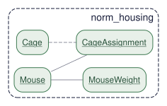
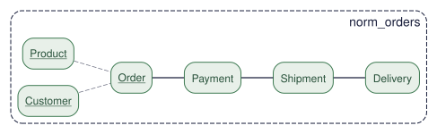

# Schema Normalization

Schema normalization ensures data integrity by organizing tables to minimize
redundancy and prevent update anomalies. DataJoint's workflow-centric approach
makes normalization intuitive.

## Three lenses on normalization

Normalization is not a single algorithm but a family of design principles that
all point toward the same goal: store each fact once, make integrity
enforceable, and keep the schema easy to query and reason about. Three
traditions arrived at these principles from different starting points, and it is
worth holding all three in view, because each illuminates a different facet of
the same design.

| Lens | One-line rule |
|------|---------------|
| **Codd** (mathematical) | Every non-key attribute depends on *the key, the whole key, and nothing but the key.* |
| **Chen** (entity) | Each table represents *one entity type*, and every attribute describes that entity. |
| **DataJoint** (workflow) | Each table holds the facts about one entity type that arise at *one workflow step*, and foreign keys prescribe the order of operations. |

The three lenses ask different questions of the same design. Codd asks which
values determine which; Chen asks what entities the domain contains; DataJoint
asks when each fact comes into being. Each lens catches what the others cannot
see, so they are not ranks on one scale. Functional dependencies cannot record
what an entity is or when a fact arises: a table can satisfy every normal form
and still merge workflow steps, as the
[order lifecycle below](#a-table-in-third-normal-form-can-still-merge-workflow-steps)
shows. A design built entity by entity tends to satisfy the classical normal
forms as a consequence, because an attribute determined by something other than
its entity describes that something instead. The analysis of functional
dependencies then serves as a check on the design.

### The mathematical lens: classical normal forms

Edgar Codd's normal forms, developed in the early 1970s, ground normalization in
**functional dependencies**. An attribute `A` *functionally determines* `B`
(written `A → B`) when a value of `A` fixes a single value of `B` — for example
`mouse_id → date_of_birth`, or `(student, course) → grade`. Normalization asks
which of these dependencies belong together in one table and which signal that a
table is doing too much.

The classical progression addresses three kinds of trouble:

- **First normal form (1NF)** — every value is atomic. No comma-separated lists,
  no `course_1 / course_2 / course_3` repeating groups. A mouse's series of
  weights does not belong in a single cell; it belongs in rows of its own table.
- **Second normal form (2NF)** — with a composite key, every non-key attribute
  depends on the *whole* key, not just part of it. In an enrollment table keyed
  by `(student, course)`, `student_name` depends on `student` alone — a partial
  dependency — so it belongs in a `Student` table.
- **Third normal form (3NF)** — no non-key attribute depends on another non-key
  attribute. If `student → department → building`, then `building` depends on
  `department`, not directly on the student — a transitive dependency — so
  `department` becomes its own table.

!!! tip "The normalization mnemonic"
    Every non-key attribute must depend on **the key, the whole key, and nothing
    but the key**. This captures 1NF, 2NF, and 3NF in a single phrase: 1NF gives
    you a key at all, 2NF is *the whole key*, and 3NF is *nothing but the key*.

This lens is rigorous and mechanically checkable, but it requires you to
enumerate functional dependencies in the abstract; it offers little guidance on
how to carve up a domain in the first place. That is where the entity lens helps.

### The entity lens: one table per entity type

Peter Chen's Entity-Relationship Model (1976) reframes normalization around the
*things* a domain is about rather than the dependencies among attributes.

!!! important "Entity Normalization Principle"
    Each table represents exactly one well-defined entity type, identified by its
    primary key. Every non-key attribute must describe that entity type
    **directly, completely, and non-optionally**.

- **Directly** — the attribute is a property of *this* entity, not of some other
  entity it references (a mouse's cage location describes the cage, not the
  mouse). This is the entity-level reading of 3NF.
- **Completely** — the attribute depends on the entire key, not a part of it.
  This is the entity-level reading of 2NF.
- **Non-optionally** — the attribute applies to every instance of the entity
  type. A nullable attribute is for a value that may be unknown, or may not
  apply, when a particular instance is entered. Attributes that are `NULL` for
  many rows are a hint that two entity types have been folded together.

A relationship with its own attributes is itself an entity type. An enrollment
that carries a `grade` is not merely an edge between `Student` and `Course`; it
is an `Enrollment` entity keyed by `(student, course)`, and `grade` describes
that enrollment directly. Whenever a relationship-set acquires attributes,
promote it to its own table.

!!! note "Tidy data is normalization rediscovered"
    Hadley Wickham's *tidy data* rules — (1) each variable is a column, (2) each
    observation is a row, (3) each type of observational unit forms its own table
    — restate normalization from the data-analysis side. Rules 1 and 2 are
    **1NF**; rule 3 is **entity normalization**. The same structure emerges
    whether you start from predicate calculus, entity modeling, or the practical
    need to plot and manipulate data cleanly.

### The workflow lens

DataJoint adds a dimension the first two leave implicit: *time*. Entity
normalization asks *what* entities exist; workflow normalization asks *when and
how* each fact about them comes into being. A table holds the facts about one
entity type that arise at one step of a workflow, and its foreign keys do
double duty — enforcing referential integrity *and* prescribing the order in
which steps may run. The rest of this page develops that lens.

## The Workflow Normalization Principle

> **"Every table represents the facts about one entity type that come into
> being at one step of a workflow, and all of its attributes describe that
> entity as it exists at that step."**

Most steps produce entities of their own: a session, a recording, a
segmentation. Some entity types have facts that arise at several steps.
Workflow normalization then splits the type across several tables, one per
step, and the tables share the entity's identity. The first step's table
identifies the entities. Each later table takes its entire primary key from a
foreign key to an earlier one, so it extends that table one to one and
[inherits its identity](entity-integrity.md#inherited-identity).

## The Intrinsic Attributes Principle

> **"Each entity should contain only its intrinsic attributes—properties that are inherent to the entity itself. Relationships, assignments, and events that happen over time belong in separate tables."**

**Full workflow entity normalization** is achieved when:

1. Each row represents a single, well-defined entity
2. Each entity is entered once when first tracked
3. Events that happen at later stages belong in separate tables

## Why Normalization Matters

Without normalization, databases suffer from:

- **Redundancy** — Same information stored multiple times
- **Update anomalies** — Changes require updating multiple rows
- **Insertion anomalies** — Can't add data without unrelated data
- **Deletion anomalies** — Deleting data loses unrelated information

## DataJoint's Approach

Traditional normalization analyzes **functional dependencies** to determine
table structure. DataJoint takes a different approach: design tables around
**workflow steps**.

### Example: Mouse Housing

**Problem: Cage is not intrinsic to a mouse.** A mouse's cage can change over time. The cage assignment is an **event** that happens after the mouse is first tracked.

**Denormalized (problematic):**

```python
# Wrong: cage info repeated for every mouse
class Mouse(dj.Manual):
    definition = """
    mouse_id : int32
    ---
    cage_id : int32
    cage_location : varchar(50)    # Redundant!
    cage_temperature : float32     # Redundant!
    weight : float32
    """
```

**Partially normalized (better, but not complete):**

```python
@schema
class Cage(dj.Manual):
    definition = """
    cage_id : int32
    ---
    location : varchar(50)
    """

@schema
class Mouse(dj.Manual):
    definition = """
    mouse_id : int32
    ---
    -> Cage    # Still treats cage as static attribute
    """
```

**Fully normalized (correct):**

```python
@schema
class Cage(dj.Manual):
    definition = """
    cage_id : int32
    ---
    location : varchar(50)
    """

@schema
class Mouse(dj.Manual):
    definition = """
    mouse_id : int32
    ---
    date_of_birth : date
    sex : enum('M', 'F')
    # Note: NO cage reference here!
    # Cage is not intrinsic to the mouse
    """

@schema
class CageAssignment(dj.Manual):
    definition = """
    -> Mouse
    assignment_date : date
    ---
    -> Cage
    """

@schema
class MouseWeight(dj.Manual):
    definition = """
    -> Mouse
    weigh_date : date
    ---
    weight : float32
    """
```



This fully normalized design:

- **Intrinsic attributes only** — `Mouse` contains only attributes determined at creation (birth date, sex)
- **Cage assignment as event** — `CageAssignment` tracks the temporal relationship between mice and cages
- **Single entity per row** — Each mouse is entered once when first tracked
- **Later events separate** — Cage assignments, weight measurements happen after initial tracking
- **History preserved** — Can track cage moves over time without data loss

`CageAssignment` carries no end date. A move is a new `CageAssignment` row, and
the earlier assignment ends where the next one begins. An end that is recorded
on its own, such as a mouse leaving the colony, is a later event and belongs in
a later table (see [Temporal Associations](#temporal-associations)).

## A table in third normal form can still merge workflow steps

A table can satisfy Codd's normal forms *and* entity normalization and still
violate workflow normalization, because neither functional dependencies nor
entity types record when a fact comes into being. Consider an e-commerce `Order`
that records the whole lifecycle of an order in a single row:

```
Order
┌───────────┬────────────┬─────────────┬──────────────┬───────────────┬───────────────┐
│ order_id* │ product_id │ customer_id │ payment_date │ shipment_date │ delivery_date │
├───────────┼────────────┼─────────────┼──────────────┼───────────────┼───────────────┤
│ 1001      │ WIDGET-A   │ C0137       │ 2026-10-16   │ 2026-10-18    │ 2026-10-20    │
│ 1002      │ GADGET-B   │ C0173       │ 2026-10-17   │ NULL          │ NULL          │
│ 1003      │ TOOL-C     │ C3310       │ NULL         │ NULL          │ NULL          │
└───────────┴────────────┴─────────────┴──────────────┴───────────────┴───────────────┘
```

- **Codd:** all values are atomic (1NF), the key is not composite (2NF is moot),
  and every attribute depends directly on `order_id` (3NF). *Perfectly
  normalized.*
- **Chen:** every column is a property of the order — payment, shipment, and
  delivery details all describe *this* order. *Perfectly normalized.*
- **DataJoint:** the attributes are created at four different moments — the order
  is placed, then paid, then shipped, then delivered. *This violates workflow
  normalization.*

The symptoms are visible in the data itself. Order 1003 is all `NULL`s downstream
because its workflow has not progressed; nothing prevents `shipment_date` from
being filled before `payment_date`; and as the order advances, the row must be
**UPDATE**d again and again. The schema cannot enforce that payment precedes
shipment, because that sequence is not expressed anywhere.

Splitting by workflow step fixes all of this:

```python
@schema
class Order(dj.Manual):
    definition = """
    order_id : int32
    ---
    order_date : datetime
    -> Product
    -> Customer
    """

@schema
class Payment(dj.Manual):
    definition = """
    -> Order                    # can't pay before ordering
    ---
    payment_date : datetime
    payment_method : enum('Credit Card', 'PayPal', 'Bank Transfer')
    amount : decimal(10, 2)
    """

@schema
class Shipment(dj.Manual):
    definition = """
    -> Payment                  # can't ship before payment clears
    ---
    shipment_date : datetime
    carrier : varchar(50)
    tracking_number : varchar(100)
    """

@schema
class Delivery(dj.Manual):
    definition = """
    -> Shipment                 # can't deliver before shipping
    ---
    delivery_date : datetime
    recipient_signature : varchar(100)
    """
```



The foreign keys now form a chain — `Order → Payment → Shipment → Delivery` —
that is simultaneously the referential-integrity structure and the workflow
diagram. The four tables represent one entity type, the order, split by the
step at which each fact arises. `Order` identifies each order, and `Payment`,
`Shipment`, and `Delivery` are keyed by `order_id` alone, each extending the
step before it one to one. Every attribute is non-nullable, because a row exists
only once its step has actually happened. There are no `NULL`s standing in for
"not yet," no updates as the order advances, and the order of operations is
enforced by construction. Workflow state becomes a query:
paid-but-not-yet-shipped orders are simply `Payment - Shipment`.

Null keeps one meaning: the value was not provided when the row was created,
because it was unknown or does not apply. A value that becomes known later is a
row of a later table, and until then it is an absent row.

!!! note
    Codd and Chen separate data by *dependency* and by *entity type*; the
    workflow lens separates it by *when it comes into being*. `payment_date`,
    `shipment_date`, and `delivery_date` are each determined by `order_id`
    alone, so no functional dependency tells them apart, and all three describe
    the order, so the entity lens keeps them together. Only the step at which
    each fact arises separates them.

## Updates as a design smell

The e-commerce redesign points to a heuristic that runs through all of
DataJoint's schemas:

!!! tip "The UPDATE test"
    Can your normal, day-to-day operations be expressed purely as **INSERT** and
    **DELETE**?

    - **Yes** → the schema is well normalized.
    - **No** → the schema needs redesign.

In a workflow-normalized schema, intrinsic attributes never change, and anything
that *does* change over time lives in its own table — usually with a date or
timestamp in the primary key, so a change is recorded as a new row rather than an
overwrite. "Updating" a mouse's weight is an `INSERT` into `MouseWeight`;
correcting a step means `DELETE` the affected row and let the cascade remove
everything downstream of it, then reinsert and recompute. Both preserve history
and keep derived results consistent with their inputs.

Reaching for `UPDATE` in ordinary operation is a signal that something is
mismodeled — a time-varying attribute was left inside an entity table, or two
workflow steps were merged. DataJoint does provide `update1()`, but it is a
surgical tool for correcting data-entry errors, and only in a row that nothing
depends on, directly or as a part of a master that something depends on.
`update1()` does not look for dependent rows, so that judgment is the caller's.
The reason is that an in-place edit to an upstream row silently invalidates
every downstream result derived from it: the foreign keys still match, so the
database raises no error, yet the derived rows now reflect inputs that no
longer exist. Deleting instead of updating makes that
dependency explicit — the cascade forces you to recompute what depended on the
corrected value, keeping the pipeline reproducible.

## The Workflow Test

Ask these questions to determine table structure:

### 1. "Is this an intrinsic attribute of the entity?"

An intrinsic attribute is inherent to the entity itself and determined when the entity is first created.

- **Intrinsic:** Mouse's date of birth, sex, genetic strain
- **Not intrinsic:** Mouse's cage (assignment that changes), weight (temporal measurement)

If not intrinsic → separate table for the relationship or event

### 2. "At which workflow step is this attribute determined?"

- If an attribute is determined at a **different step**, it belongs in a **different table**
- If an attribute **changes over time**, it needs its own table with a **temporal key**

### 3. "Is this a relationship or event?"

- **Relationships** (cage assignment, group membership) → association table with temporal keys
- **Events** (measurements, observations) → separate table with event date/time
- **States** (approval status, processing stage) → state transition table

## Common Patterns

### Lookup Tables

Declare reference data with the table. The rows in `contents` are part of the
schema definition and are versioned with the code:

```python
@schema
class Species(dj.Lookup):
    definition = """
    species : varchar(50)
    ---
    common_name : varchar(100)
    """
    contents = [
        ('Mus musculus', 'House mouse'),
        ('Rattus norvegicus', 'Brown rat'),
    ]
```

### Parameter Sets

Store versioned configurations. A new parameter set is a new row in `contents`:

```python
@schema
class AnalysisParams(dj.Lookup):
    definition = """
    params_id : int32
    ---
    threshold : float32
    window_size : int32
    """
    contents = [
        (1, 0.5, 100),
        (2, 0.8, 200),
    ]
```

### Temporal Tracking

Track measurements or observations over time:

```python
@schema
class SubjectWeight(dj.Manual):
    definition = """
    -> Subject
    weight_date : date
    ---
    weight : float32   # grams
    """
```

### Temporal Associations

Track relationships or assignments that change over time:

```python
@schema
class GroupAssignment(dj.Manual):
    definition = """
    -> Subject
    -> ExperimentalGroup
    assignment_date : date
    """

@schema
class GroupRemoval(dj.Manual):
    definition = """
    -> GroupAssignment         # an assignment ends at most once
    ---
    removal_date : date
    """

@schema
class HousingAssignment(dj.Manual):
    definition = """
    -> Animal
    move_date : date
    ---
    -> Cage
    move_reason : varchar(200)
    """
```

**Key pattern:** The relationship itself (subject-to-group, animal-to-cage) is **not intrinsic** to either entity. It's a temporal event that happens during the workflow.

The end of an assignment is a later event, so it is a row of a later table.
`GroupRemoval` takes its entire primary key from `GroupAssignment`. A subject
may belong to several groups at once, so a new group assignment does not end an
earlier one, as a new cage assignment does; each group assignment ends with its
own `GroupRemoval` row, and the assignments still in force are
`GroupAssignment - GroupRemoval`. A nullable
`removal_date` on `GroupAssignment` would make null stand for "not yet" and
would need an update to fill.

## Benefits in DataJoint

1. **Natural from workflow thinking** — Designing around workflow steps
   naturally produces normalized schemas

2. **Cascade deletes** — Normalization + foreign keys enable safe cascade
   deletes that maintain consistency

3. **Join efficiency** — Normalized tables with proper keys enable efficient
   joins through the workflow graph

4. **Clear lineage** — Each table represents a distinct workflow step,
   making data lineage clear

## Summary

!!! note "The three lenses at a glance"
    - **Codd (mathematical):** depend on the key, the whole key, and nothing but
      the key.
    - **Chen (entity):** each table is one entity type; every attribute describes
      it directly, completely, and non-optionally.
    - **DataJoint (workflow):** each table holds the facts about one entity
      type that arise at one workflow step; foreign keys define the order of
      operations.

    Each lens catches what the others cannot see. Functional dependencies and
    entity types do not record *when* a fact comes into being; the workflow
    lens does.

**Core principles:**

1. **Intrinsic attributes only** — Each entity contains only properties inherent to itself
2. **One entity, one entry** — Each entity entered once when first tracked
3. **Events separate** — Relationships, assignments, measurements that happen later belong in separate tables
4. **Workflow steps** — Design tables around the workflow step that creates each entity
5. **Temporal keys** — Relationships and observations that change over time need temporal keys (dates, timestamps)

**Ask yourself:**

- Is this attribute intrinsic to the entity? (No → separate table)
- Does this attribute change over time? (Yes → temporal table)
- Is this a relationship or event? (Yes → association/event table)

Following these principles achieves **full workflow entity normalization** where each table holds the facts about a single, well-defined entity type that arise at one workflow step.

## See also

- [Entity Integrity](entity-integrity.md) — the one-to-one correspondence
  between entities and rows, and the primary key's part in it
- [Design Primary Keys](../how-to/design-primary-keys.md) — choosing the keys
  that identify each normalized entity
- [Model Relationships](../how-to/model-relationships.ipynb) — connecting
  normalized entities with foreign keys
- [Relational Workflow Model](relational-workflow-model.md) — the broader frame
  in which normalization, entity integrity, and referential integrity work
  together
