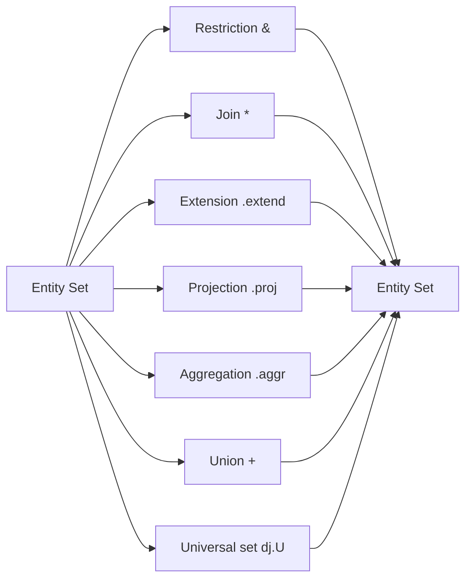

# Query Algebra

DataJoint queries are written in a query algebra whose operators are restriction, anti-restriction, projection, join, extension, aggregation, and union. The universal set `dj.U` supplies an entity set for attributes that are the primary key of no table. Every operator takes **entity sets** (tables and other query expressions) and returns an entity set, so any result can be the operand of another operator.

## Algebraic Closure

A fundamental property of DataJoint's query algebra is **algebraic closure**: every query result is itself a valid entity set with a well-defined **entity type** — you always know what kind of entity the result represents, identified by a specific primary key. Unlike SQL where query results are unstructured "bags of rows," DataJoint determines the entity type of each result from the operator and from which operand determines the other.

This means operators can be chained indefinitely — the output of any operation is a valid input to any other operation. See [Primary Keys](../reference/specs/primary-keys.md/) for the precise rules.

## Core Operators



## Restriction and Anti-restriction (`&`, `-`)

Filter entities based on conditions.

### Restriction (`&`)

`A & c` keeps the entities of `A` that match the condition `c`.

```python
# Mice born after 2024
Mouse & "date_of_birth > '2024-01-01'"

# Sessions for a specific mouse
Session & {'mouse_id': 42}

# Sessions matching a query
Session & (Mouse & "strain = 'C57BL/6'")
```

### Anti-restriction (`-`)

`A - c` keeps the entities of `A` that do not match it.

```python
# Mice NOT in the study
Mouse - StudyMouse

# Sessions without recordings
Session - Recording
```

### Top N (`dj.Top`)

Select a limited number of entities with ordering:

```python
# Most recent 10 sessions
Session & dj.Top(10, 'session_date DESC')

# First session by primary key
Session & dj.Top()
```

The `order_by` parameter accepts attribute names with optional `DESC`/`ASC`. The special value `"KEY"` is an alias for all primary key attributes (e.g., `"KEY DESC"` for reverse primary key order).

## Join (`*`)

Combine entity sets along shared attributes.

```python
# All session-recording pairs
Session * Recording

# Chain through workflow
Mouse * Session * Scan * Segmentation
```

DataJoint joins are **natural joins** that:

- Match on attributes with the same name **and** lineage
- Respect declared dependencies (no accidental matches)
- Produce the intersection of matching entities

### Primary Key of a Join

`A` **determines** `B`, written `A → B`, when every primary key attribute of `B` is an attribute of `A`, primary or secondary. Each entity of `A` then matches at most one entity of `B`.

| Case | Primary key of `A * B` | Each row is |
|------|------------------------|-------------|
| `A → B` | PK(A) | An entity of `A` |
| `B → A` only | PK(B) | An entity of `B` |
| Neither | PK(A) ∪ PK(B) | A pair: one entity of `A` and one of `B` |

```python
# Trial contains Session's primary key, so Trial → Session
Session * Trial
# PK: (session_id, trial_num), the same as Trial's: one row per trial

# Neither determines the other
Mouse * Experimenter
# PK: (mouse_id, experimenter_id): one row per pair
```

`A * B` and `B * A` return the same rows. See [Primary Keys](../reference/specs/primary-keys.md) for the full rule, with examples of each case.

## Extension (`.extend()`)

Attach the attributes of another entity set to every entity of the left operand.

```python
# Add session info to each trial
Trial.extend(Session)  # Adds session_date, subject_id to Trial

# Add neuron properties to spike times
SpikeTime.extend(Neuron)  # Adds cell_type, depth to SpikeTime
```

**How it differs from join:**

- **Join (`*`)**: Returns only the entities that match. The primary key follows the rule above.
- **Extension**: Returns every entity of the left operand, with NULL in the added attributes where nothing matches. The primary key is the left operand's.

**Primary key formation:**

```python
# Join: Trial determines Session, so the PK is Trial's
result = Session * Trial
# PK: (session_id, trial_num)

# Extension: PK stays as the left operand's
result = Trial.extend(Session)
# PK: (session_id, trial_num) - same as Trial
# session_date is added as a non-primary attribute
```

**Requirement:** The left operand must **determine** the right operand: every primary key attribute of the right operand must exist in the left operand. This requirement ensures:

1. Every entity in the left operand can match at most one entity in the right operand
2. The left operand's primary key uniquely identifies entities in the result
3. No NULL values appear in the result's primary key

```python
# Valid: Trial determines Session
# (session_id is in Trial's primary key)
Trial.extend(Session)  ✓
# Each trial belongs to exactly one session
# Result PK: (session_id, trial_num)

# Invalid: Session does NOT determine Trial
# (trial_num is not in Session)
Session.extend(Trial)  ✗  # Error: trial_num not in Session
# A session has multiple trials - PK would be ambiguous
```

A join drops the entities of the left operand that have no match, and extension keeps them. An entity has no match when its optional reference is empty, when the right operand is restricted, or when the two tables share a parent and the right one has no row for the entity.

```python
# Session declares an optional reference: -> [nullable] Experimenter
Session * Experimenter         # Only the sessions that name an experimenter
Session.extend(Experimenter)   # Every session; NULL where none is named

# Restricted right operand
Trial.extend(Session & "session_date > '2024-01-01'")
# Every trial; session_date is NULL for trials of sessions on or before that date
```

!!! version-changed "Changed after 2.3.6"
    Through release 2.3.6, a restriction on the right operand is applied after the left join, which drops the entities of the left operand that the restriction leaves without a match, as a join does. The same holds for aggregation and for a union of operands with secondary attributes, which use the same left join. Later releases keep these entities.

When every entity of the left operand has a match, as under a required foreign key to an unrestricted table, `A.extend(B)` returns the same rows as `A * B`.

Extension is projection-like: it adds attributes to existing entities without changing which entities are present.

## Projection (`.proj()`)

Select and transform attributes.

### Select attributes

```python
# Only mouse_id and strain
Mouse.proj('strain')

# Rename attributes
Mouse.proj(animal_id='mouse_id')
```

### Compute new attributes

```python
# Calculate age
Mouse.proj(
    age='DATEDIFF(CURDATE(), date_of_birth)'
)

# Combine attributes
Session.proj(
    session_label='CONCAT(subject_id, "-", session_date)'
)
```

### Aggregate in projection

```python
# Count trials per session
Session.aggr(Trial, n_trials='COUNT(trial_num)')
```

## Aggregation (`.aggr()`)

`A.aggr(B, ...)` computes, for each entity of `A`, summaries over the entities of `B` that match it. `B` must contain every primary key attribute of `A`. The result has one row per entity of `A`, with `A`'s primary key. An entity with no match is kept and summarized over no entities: a count of its matches is zero, and an aggregate that is undefined over an empty set, such as an average, is NULL.

```python
# Trials per session and their success rate
Session.aggr(
    Trial,
    n_trials='COUNT(trial_num)',
    success_rate='AVG(success)'
)

# Average spike rate per neuron
Neuron.aggr(SpikeTime, avg_rate='AVG(spike_rate)')
```

To count matches, count a primary key attribute of `B` that `A` does not have, such as `trial_num`. `COUNT(*)` returns 1 for an entity with no match, because it counts the row that the underlying left join pads with NULLs.

## Union (`+`)

Combine two entity sets that have the same primary key and no secondary attributes in common. An entity present in both operands appears once, with the secondary attributes of both. An entity present in only one has NULL in the other's secondary attributes.

```python
# Both tables are keyed by Session's primary key and declare different
# secondary attributes: one row per session that has either summary
BehaviorSummary + ImagingSummary

# Both keyed by Session's primary key, with secondary attributes of the
# same names: combine their keys
AnalysisV1.proj() + AnalysisV2.proj()
```

Requirements:

- The same primary key
- No secondary attribute names in common

## Universal Sets (`dj.U`)

`dj.U('a', 'b')` stands for the entity set of all value combinations of the named attributes, with those attributes as its primary key. It appears in two forms: restricted by a query expression, and as the left operand of an aggregation.

```python
# The distinct session dates, as an entity set keyed by session_date
dj.U('session_date') & Session

# Sessions per date
dj.U('session_date').aggr(Session, n='COUNT(*)')

# One row that summarizes all sessions
dj.U().aggr(Session, n='COUNT(*)', mean_duration='AVG(duration)')
```

A universal set is for grouping attributes that are the primary key of no table. When a table has them as its primary key, aggregate over that table: `Experimenter.aggr(Session, n='COUNT(session_id)')` returns every experimenter, including those with no sessions, whereas `dj.U('experimenter_id').aggr(Session, n='COUNT(*)')` returns only the experimenters that appear in `Session`.

See the [Query Algebra Specification](../reference/specs/query-algebra.md#8-universal-sets-dju) for the accepted and rejected forms.

## Operator Composition

Operators compose freely:

```python
# Complex query
result = (
    (Mouse & "strain = 'C57BL/6'")  # Filter mice
    * Session                        # Join sessions
    * Scan                           # Join scans
    .proj('scan_date', 'depth')      # Select attributes
    & 'depth > 200'                  # Filter by depth
)
```

## Semantic Matching

All binary operators in DataJoint rely on **semantic matching** of attributes. Unlike SQL's natural joins that match on any shared column name, DataJoint verifies that namesake attributes (those with the same name) are **homologous**—they trace back to the same original definition.

This prevents accidental matches on coincidentally-named columns, a pitfall that has been understood since the Entity-Relationship Model was introduced in the 1970s but was never addressed in SQL or traditional RDBMS implementations.

See [Semantic Matching](semantic-matching.md) for details.

These concepts were first introduced in Yatsenko et al., 2018[^1].

[^1]: Yatsenko D, Walker EY, Tolias AS (2018). DataJoint: A Simpler Relational Data Model. [arXiv:1807.11104](https://doi.org/10.48550/arXiv.1807.11104)

## Fetching Results

Query expressions are lazy—they build SQL but don't execute until you fetch:

```python
# Fetch as NumPy recarray
data = query.to_arrays()

# Fetch as list of dicts
data = query.to_dicts()

# Fetch as pandas DataFrame
df = query.to_pandas()

# Fetch specific attributes
ids, dates = query.to_arrays('mouse_id', 'session_date')

# Fetch single row
row = (query & key).fetch1()
```

## Summary

| Operator | Symbol/Method | Purpose |
|----------|---------------|---------|
| Restriction | `&` | Keep the entities that match a condition |
| Anti-restriction | `-` | Keep the entities that do not match it |
| Join | `*` | Combine the matching entities of two sets |
| Extension | `.extend()` | Add another set's attributes, keeping every entity |
| Projection | `.proj()` | Select, rename, and compute attributes |
| Aggregation | `.aggr()` | Summarize the matching entities of another set |
| Union | `+` | Combine sets that have the same primary key |
| Universal set | `dj.U()` | Key an entity set by attributes that are the primary key of no table |
