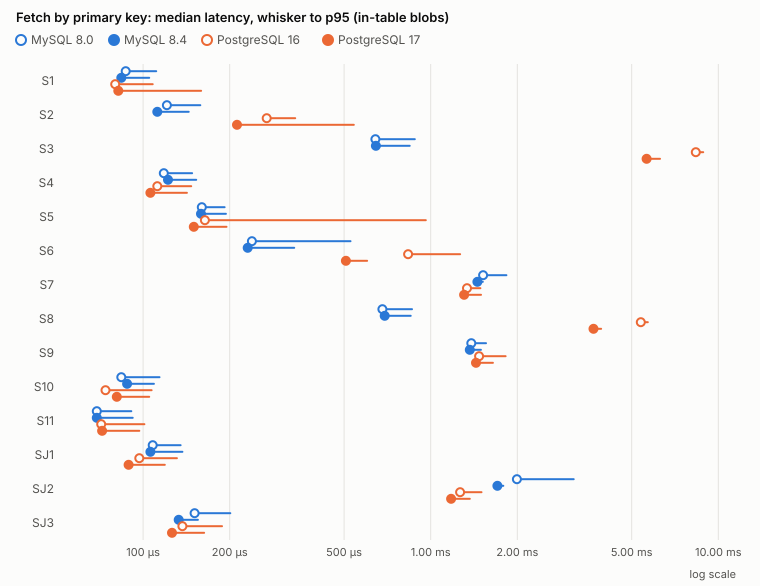
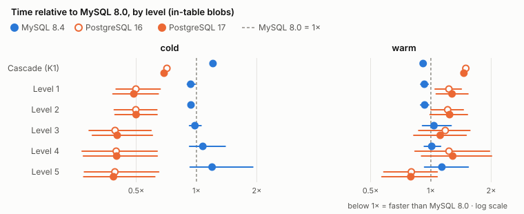
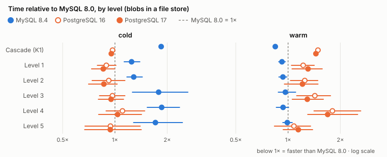

# Backend Performance: MySQL and PostgreSQL

This page reports how fast the same DataJoint queries run on MySQL 8.0, MySQL 8.4,
PostgreSQL 16 and PostgreSQL 17. It covers:

- simple queries that fetch entries by primary key;
- complex queries nested one to five levels deep;
- blobs stored in the table, blobs in a file store, and JSON attributes.

!!! note "Version measured"
    DataJoint `master` at `eefe74b4` (2.3.5 development) with
    [datajoint-python#1671](https://github.com/datajoint/datajoint-python/pull/1671) merged in, and
    subquery pruning on (`prune_subqueries = True`). Pruning
    keeps unused columns, such as blobs, out of the subqueries that the database materializes.
    Without it, MySQL copies whole rows into temporary tables for Top, aggregation and union
    subqueries; see [datajoint-python#1665](https://github.com/datajoint/datajoint-python/issues/1665).

## Summary

- **Fetching small entries by primary key** takes 70–165 µs per call on all four engines,
  within about 25 µs of each other. The client side, meaning the network round trip, the
  driver and DataJoint, makes up most of it.
- **Large in-table blobs are fetched much faster from MySQL.** A 4 MB value takes 0.64 ms on
  MySQL, 8.4 ms on PostgreSQL 16 and 5.6 ms on PostgreSQL 17. The cost on PostgreSQL is
  encoding the value as hex text for transfer. With blobs in a file store, all engines take
  the same time.
- **On cold runs with in-table blobs, PostgreSQL is about 2–2.5× faster** at every level of
  nesting. It is faster on 44 or 45 of 51 complex queries. MySQL stores large values on pages
  interleaved with the table's index pages, so a cold scan reads scattered single pages.
  PostgreSQL keeps large values in a separate table. With blobs in a file store, PostgreSQL and
  MySQL 8.0 are about even, and MySQL 8.4 is slower.
- **On warm runs, MySQL is slightly faster.** With in-table blobs, 31 of 51 queries tie
  between PostgreSQL 16 and MySQL 8.0 under the tie rule (10% or 5 ms); MySQL is faster on 12
  and PostgreSQL on 8, and PostgreSQL's geometric mean is about 1.2× MySQL's at levels 1–4.
  With blobs in a file store, 24 tie and MySQL 8.0 is faster on 23, most of all at levels 3–4
  (1.4–1.8×).
- **Each engine wins a different JSON operation.** PostgreSQL turns whole documents into text
  1.6–1.9× as fast.
  MySQL extracts a key from a large document 20× faster, because PostgreSQL first decompresses
  the whole document.
- **Cold, MySQL 8.4 is slower than 8.0:** 1.25–1.86× per level in the file-store copy, and up
  to about 5× on single queries that read large values. This comes from 8.4's new default
  `innodb_flush_method = O_DIRECT`; setting it back to `fsync` restores 8.0's times. Warm, the
  two versions are about equal.
- **PostgreSQL 17 matches 16** on 47–50 of 51 complex queries. It is about a third faster
  when sending large values.
- **Every query returned the same result on all four engines.**

## What this means for a pipeline

- **Once data are cached, most pipeline queries differ by a few milliseconds between
  engines** (median spread 6–8 ms). That covers fetching entries, restricting, joining,
  aggregating, and populate's key-source queries. Cold reads differ more.
- **On PostgreSQL, keep large arrays in a file or object store if they are fetched often.**
  In-table `bytea` costs about 1.2–2 ms per MB to fetch, against about 0.15–0.25 ms on MySQL.
  With blobs in a local file store, both engines spend the same time, almost all of it on the
  client reading the file. A remote object store adds its own latency, which was not
  measured here.
- **On PostgreSQL, do not filter on keys inside large JSON documents.** Extracting one key from
  1,000 documents of 130 KB took 75 ms, against 3.4 ms on MySQL. Keep values used in
  restrictions in their own attributes, or in small documents. If large documents must be
  searched, storing them with lz4 compression cut the time 2.7× in this test
  (`ALTER TABLE … ALTER COLUMN … SET COMPRESSION lz4`, or `default_toast_compression = lz4`
  before the data are written; existing values keep their compression until rewritten).
- **On MySQL with in-table blobs, cold queries pay for scattered reads.** A buffer pool large
  enough to keep the tables' index pages cached, or blobs in a file or object store, avoids
  it.
- **When moving to MySQL 8.4, check `innodb_flush_method`.** `O_DIRECT` avoids caching data
  twice on servers with a large buffer pool, but here it made cold reads slower. Which is
  better depends on the storage and on how much data fits in the buffer pool.

## Results

### Simple queries: fetch by primary key

<!-- BEGIN:simple -->
Median (p50) and 95th-percentile (p95) latency per call, in-table blobs:

| Query | My 8.0 p50 | My 8.4 p50 | PG 16 p50 | PG 17 p50 | My 8.0 p95 | My 8.4 p95 | PG 16 p95 | PG 17 p95 |
| --- | ---: | ---: | ---: | ---: | ---: | ---: | ---: | ---: |
| `S1` (Session & key).fetch1() | 87 µs | 84 µs | 80 µs | 82 µs | 111 µs | 105 µs | 108 µs | 159 µs |
| `S2` (Unit & key).fetch1(): 100 KB blob | 121 µs | 112 µs | 269 µs | 212 µs | 158 µs | 144 µs | 338 µs | 540 µs |
| `S3` (Recording & key).fetch1(): 4 MB blob | 642 µs | 645 µs | 8.35 ms | 5.63 ms | 880 µs | 845 µs | 8.86 ms | 6.27 ms |
| `S4` (Unit & key).fetch1('snr', 'firing_rate') | 118 µs | 122 µs | 112 µs | 106 µs | 148 µs | 153 µs | 147 µs | 142 µs |
| `S5` (Session * Recording & key).fetch1('session_date', 'duration') | 160 µs | 159 µs | 164 µs | 150 µs | 192 µs | 194 µs | 961 µs | 195 µs |
| `S6` (Unit * UnitSpikes & key).fetch1('snr', 'spike_times'): 300 KB blob | 239 µs | 231 µs | 834 µs | 507 µs | 526 µs | 335 µs | 1.27 ms | 601 µs |
| `S7` (Trial & session).to_arrays('trial_id', 'outcome', 'start_time'): 300 rows | 1.52 ms | 1.45 ms | 1.34 ms | 1.31 ms | 1.83 ms | 1.52 ms | 1.49 ms | 1.50 ms |
| `S8` (Unit & session).to_dicts(): 30 rows x 100 KB | 679 µs | 692 µs | 5.38 ms | 3.68 ms | 861 µs | 852 µs | 5.69 ms | 3.91 ms |
| `S9` (Unit & list of 100 keys).to_arrays('snr', 'firing_rate') | 1.38 ms | 1.37 ms | 1.47 ms | 1.44 ms | 1.56 ms | 1.50 ms | 1.82 ms | 1.65 ms |
| `S10` len(Unit & session) | 84 µs | 88 µs | 74 µs | 81 µs | 114 µs | 109 µs | 107 µs | 105 µs |
| `S11` bool(UnitSpikes & key) | 69 µs | 69 µs | 72 µs | 72 µs | 91 µs | 92 µs | 101 µs | 97 µs |
| `SJ1` (UnitQuality & key).fetch1(): 2 KB JSON | 108 µs | 106 µs | 97 µs | 89 µs | 135 µs | 137 µs | 131 µs | 119 µs |
| `SJ2` (RecordingConfig & key).fetch1(): 130 KB JSON | 1.99 ms | 1.71 ms | 1.26 ms | 1.18 ms | 3.14 ms | 1.79 ms | 1.50 ms | 1.37 ms |
| `SJ3` (SessionMeta * Session & key).fetch1(): 1 KB JSON | 151 µs | 133 µs | 137 µs | 126 µs | 201 µs | 155 µs | 188 µs | 163 µs |
<!-- END:simple -->

Small fetches (S1, S4, S5, S7, S9–S11, SJ1, SJ3) are within about 20% across all four
engines: at most 25 µs per call apart, or 0.2 ms for the 300-row S7. PostgreSQL is slightly
faster on several of them. Large values are where the engines differ:

- **In-table blobs (S2, S3, S6, S8).** PostgreSQL is 1.8–13× slower, and the gap grows with
  the number of bytes fetched per call: about 2× for one 100 KB value (S2), 5–8× for 30 such
  values (S8) and 9–13× for one 4 MB value (S3). psycopg2 receives `bytea` in text format, so the server encodes each value
  as hex and sends twice its size. Measured for one 4 MB value:

    | Step | PostgreSQL 16 | PostgreSQL 17 |
    |---|---:|---:|
    | Read the value from TOAST storage | 0.25 ms | 0.24 ms |
    | Hex-encode it with `encode()` and take the length, without sending it | 7.1 ms | 7.0 ms |
    | Fetch it as a query result (hex text) | 8.0 ms | 5.3 ms |
    | Fetch the same bytes in binary format (`COPY … (FORMAT binary)`) | 2.1 ms | 0.76 ms |

    The `encode()` row also builds the 8 MB of text in memory, so it is an upper bound on the
    encoding cost; on PostgreSQL 17 the whole fetch is faster than this step. On MySQL the same
    fetch took 1.2 ms in this experiment and 0.6 ms as a bare driver call in S3.

    The `encode()` step takes the same time on both PostgreSQL versions, while both the hex-text
    fetch and the binary transfer are faster on 17 (by 2.7 ms and 1.3 ms). That points to
    PostgreSQL 17 sending large messages faster, though the send step was not timed on its own.
    Binary transfer would remove most of the gap to MySQL.
- **Blobs in a file store.** All engines take the same time: about 6 ms for a 4 MB value and
  0.3 ms for 100 KB. The database returns only a short reference; the time is spent on the
  client, reading the file and verifying its checksum.
- **Large JSON (SJ2, about 130 KB of text).** PostgreSQL is about 1.5× faster: 1.2 ms against
  1.7–2.0 ms. The difference is turning stored JSON into text on the server (see [JSON](#json)).

??? note "Where the time goes in a simple query"
    <!-- BEGIN:attribution -->
    Where the time goes per call: server-reported time (mean), a bare driver call on the same connection (median), and the DataJoint call (median). Server-reported time has a different scope on each engine (see Method).

    | Query | My 8.0 engine / driver / DataJoint | My 8.4 engine / driver / DataJoint | PG 16 engine / driver / DataJoint | PG 17 engine / driver / DataJoint |
    | --- | ---: | ---: | ---: | ---: |
    | `S1` | 19 µs / 56 µs / 87 µs | 17 µs / 55 µs / 84 µs | 7 µs / 45 µs / 80 µs | 8 µs / 45 µs / 82 µs |
    | `S2` | 43 µs / 83 µs / 121 µs | 37 µs / 77 µs / 112 µs | 145 µs / 224 µs / 269 µs | 99 µs / 168 µs / 212 µs |
    | `S3` | 491 µs / 595 µs / 642 µs | 483 µs / 592 µs / 645 µs | 6.41 ms / 8.28 ms / 8.35 ms | 3.86 ms / 5.47 ms / 5.63 ms |
    | `S4` | 20 µs / 58 µs / 118 µs | 19 µs / 59 µs / 122 µs | 9 µs / 47 µs / 112 µs | 8 µs / 46 µs / 106 µs |
    | `S5` | 23 µs / 60 µs / 160 µs | 21 µs / 59 µs / 159 µs | 16 µs / 57 µs / 164 µs | 13 µs / 51 µs / 150 µs |
    | `S6` | 73 µs / 113 µs / 239 µs | 65 µs / 106 µs / 231 µs | 464 µs / 649 µs / 834 µs | 216 µs / 377 µs / 507 µs |
    | `S7` | 122 µs / 616 µs / 1.52 ms | 95 µs / 583 µs / 1.45 ms | 68 µs / 155 µs / 1.34 ms | 66 µs / 148 µs / 1.31 ms |
    | `S8` | 478 µs / 519 µs / 679 µs | 473 µs / 524 µs / 692 µs | 3.85 ms / 5.12 ms / 5.38 ms | 2.14 ms / 3.42 ms / 3.68 ms |
    | `S9` | 381 µs / 576 µs / 1.38 ms | 367 µs / 564 µs / 1.37 ms | 295 µs / 540 µs / 1.47 ms | 284 µs / 522 µs / 1.44 ms |
    | `S10` | 31 µs / 60 µs / 84 µs | 27 µs / 56 µs / 88 µs | 13 µs / 50 µs / 74 µs | 13 µs / 51 µs / 81 µs |
    | `S11` | 20 µs / 48 µs / 69 µs | 17 µs / 46 µs / 69 µs | 10 µs / 46 µs / 72 µs | 9 µs / 46 µs / 72 µs |
    | `SJ1` | 31 µs / 70 µs / 108 µs | 28 µs / 67 µs / 106 µs | 13 µs / 53 µs / 97 µs | 12 µs / 48 µs / 89 µs |
    | `SJ2` | 1.35 ms / 1.38 ms / 1.99 ms | 1.07 ms / 1.12 ms / 1.71 ms | 578 µs / 631 µs / 1.26 ms | 519 µs / 564 µs / 1.18 ms |
    | `SJ3` | 30 µs / 72 µs / 151 µs | 21 µs / 61 µs / 133 µs | 16 µs / 57 µs / 137 µs | 14 µs / 52 µs / 126 µs |
    <!-- END:attribution -->

??? note "Simple queries with blobs in a file store"
    <!-- BEGIN:simple-store -->
    | Query | My 8.0 p50 | My 8.4 p50 | PG 16 p50 | PG 17 p50 | My 8.0 p95 | My 8.4 p95 | PG 16 p95 | PG 17 p95 |
    | --- | ---: | ---: | ---: | ---: | ---: | ---: | ---: | ---: |
    | `S1` (Session & key).fetch1() | 96 µs | 83 µs | 78 µs | 72 µs | 924 µs | 103 µs | 961 µs | 102 µs |
    | `S2` (Unit & key).fetch1(): 100 KB blob | 310 µs | 291 µs | 292 µs | 283 µs | 404 µs | 320 µs | 364 µs | 342 µs |
    | `S3` (Recording & key).fetch1(): 4 MB blob | 6.05 ms | 5.81 ms | 5.92 ms | 6.22 ms | 6.77 ms | 6.46 ms | 6.40 ms | 6.88 ms |
    | `S4` (Unit & key).fetch1('snr', 'firing_rate') | 119 µs | 118 µs | 108 µs | 106 µs | 173 µs | 147 µs | 141 µs | 137 µs |
    | `S5` (Session * Recording & key).fetch1('session_date', 'duration') | 157 µs | 173 µs | 150 µs | 147 µs | 197 µs | 372 µs | 191 µs | 186 µs |
    | `S6` (Unit * UnitSpikes & key).fetch1('snr', 'spike_times'): 300 KB blob | 705 µs | 662 µs | 673 µs | 661 µs | 814 µs | 820 µs | 846 µs | 766 µs |
    | `S7` (Trial & session).to_arrays('trial_id', 'outcome', 'start_time'): 300 rows | 1.49 ms | 1.46 ms | 1.32 ms | 1.29 ms | 2.06 ms | 1.56 ms | 1.46 ms | 1.43 ms |
    | `S8` (Unit & session).to_dicts(): 30 rows x 100 KB | 5.53 ms | 5.40 ms | 5.86 ms | 5.58 ms | 6.02 ms | 5.94 ms | 7.28 ms | 6.04 ms |
    | `S9` (Unit & list of 100 keys).to_arrays('snr', 'firing_rate') | 1.42 ms | 1.35 ms | 1.42 ms | 1.38 ms | 1.64 ms | 1.40 ms | 1.59 ms | 1.57 ms |
    | `S10` len(Unit & session) | 85 µs | 77 µs | 71 µs | 70 µs | 118 µs | 97 µs | 100 µs | 100 µs |
    | `S11` bool(UnitSpikes & key) | 71 µs | 68 µs | 65 µs | 64 µs | 99 µs | 84 µs | 94 µs | 93 µs |
    | `SJ1` (UnitQuality & key).fetch1(): 2 KB JSON | 120 µs | 103 µs | 89 µs | 87 µs | 305 µs | 124 µs | 120 µs | 116 µs |
    | `SJ2` (RecordingConfig & key).fetch1(): 130 KB JSON | 2.00 ms | 1.71 ms | 1.24 ms | 1.19 ms | 2.37 ms | 1.90 ms | 1.43 ms | 1.87 ms |
    | `SJ3` (SessionMeta * Session & key).fetch1(): 1 KB JSON | 139 µs | 133 µs | 133 µs | 135 µs | 179 µs | 155 µs | 170 µs | 322 µs |

    Where the time goes per call: server-reported time (mean), a bare driver call on the same connection (median), and the DataJoint call (median). Server-reported time has a different scope on each engine (see Method).

    | Query | My 8.0 engine / driver / DataJoint | My 8.4 engine / driver / DataJoint | PG 16 engine / driver / DataJoint | PG 17 engine / driver / DataJoint |
    | --- | ---: | ---: | ---: | ---: |
    | `S1` | 24 µs / 64 µs / 96 µs | 16 µs / 54 µs / 83 µs | 8 µs / 45 µs / 78 µs | 7 µs / 43 µs / 72 µs |
    | `S2` | 26 µs / 71 µs / 310 µs | 18 µs / 64 µs / 291 µs | 10 µs / 53 µs / 292 µs | 9 µs / 49 µs / 283 µs |
    | `S3` | 53 µs / 96 µs / 6.05 ms | 31 µs / 81 µs / 5.81 ms | 17 µs / 86 µs / 5.92 ms | 26 µs / 126 µs / 6.22 ms |
    | `S4` | 22 µs / 58 µs / 119 µs | 18 µs / 57 µs / 118 µs | 9 µs / 46 µs / 108 µs | 8 µs / 46 µs / 106 µs |
    | `S5` | 23 µs / 59 µs / 157 µs | 30 µs / 66 µs / 173 µs | 13 µs / 52 µs / 150 µs | 13 µs / 51 µs / 147 µs |
    | `S6` | 33 µs / 80 µs / 705 µs | 26 µs / 69 µs / 662 µs | 19 µs / 66 µs / 673 µs | 18 µs / 64 µs / 661 µs |
    | `S7` | 127 µs / 605 µs / 1.49 ms | 97 µs / 584 µs / 1.46 ms | 66 µs / 150 µs / 1.32 ms | 64 µs / 145 µs / 1.29 ms |
    | `S8` | 60 µs / 161 µs / 5.53 ms | 46 µs / 146 µs / 5.40 ms | 40 µs / 146 µs / 5.86 ms | 28 µs / 92 µs / 5.58 ms |
    | `S9` | 399 µs / 599 µs / 1.42 ms | 361 µs / 559 µs / 1.35 ms | 278 µs / 514 µs / 1.42 ms | 269 µs / 494 µs / 1.38 ms |
    | `S10` | 32 µs / 60 µs / 85 µs | 26 µs / 54 µs / 77 µs | 12 µs / 50 µs / 71 µs | 12 µs / 49 µs / 70 µs |
    | `S11` | 20 µs / 48 µs / 71 µs | 17 µs / 46 µs / 68 µs | 9 µs / 46 µs / 65 µs | 9 µs / 45 µs / 64 µs |
    | `SJ1` | 37 µs / 77 µs / 120 µs | 26 µs / 65 µs / 103 µs | 12 µs / 49 µs / 89 µs | 12 µs / 48 µs / 87 µs |
    | `SJ2` | 1.34 ms / 1.37 ms / 2.00 ms | 1.07 ms / 1.12 ms / 1.71 ms | 567 µs / 614 µs / 1.24 ms | 546 µs / 573 µs / 1.19 ms |
    | `SJ3` | 25 µs / 64 µs / 139 µs | 21 µs / 61 µs / 133 µs | 15 µs / 55 µs / 133 µs | 18 µs / 55 µs / 135 µs |
    <!-- END:simple-store -->

### Complex queries by level of nesting

The level of a query is the height of its operator tree. A join chain, an aggregation, a
Top, a union, a computed projection, a restriction by a query expression and a complement of
a restriction (`A - B`) each count as one level. The [query catalog](#queries) lists every
query.

=== "In-table blobs"

    <!-- BEGIN:levels-inline -->
    **Cold**, geometric mean of per-query time ratios (95% bootstrap interval):

    | Level | Queries | My 8.4 / My 8.0 | PG 16 / My 8.0 | PG 17 / My 8.0 |
    | --- | ---: | ---: | ---: | ---: |
    | Cascade (K1) | 1 | 1.21× | 0.71× | 0.69× |
    | Level 1 | 13 | 0.94× (0.90×–0.98×) | 0.50× (0.40×–0.66×) | 0.49× (0.38×–0.64×) |
    | Level 2 | 14 | 0.94× (0.92×–0.96×) | 0.50× (0.39×–0.63×) | 0.50× (0.39×–0.64×) |
    | Level 3 | 7 | 0.98× (0.92×–1.06×) | 0.39× (0.29×–0.59×) | 0.40× (0.30×–0.60×) |
    | Level 4 | 9 | 1.08× (0.92×–1.39×) | 0.40× (0.27×–0.64×) | 0.40× (0.27×–0.64×) |
    | Level 5 | 7 | 1.20× (0.93×–1.91×) | 0.39× (0.28×–0.65×) | 0.39× (0.27×–0.62×) |

    Faster / tied / slower, query counts (tie: under 10% or 5 ms):

    | Level | PG 16 vs My 8.0 | PG 17 vs My 8.4 | PG 17 vs My 8.0 | My 8.4 vs My 8.0 | PG 17 vs PG 16 |
    | --- | ---: | ---: | ---: | ---: | ---: |
    | Cascade (K1) | 1 / 0 / 0 | 1 / 0 / 0 | 1 / 0 / 0 | 0 / 0 / 1 | 0 / 1 / 0 |
    | Level 1 | 11 / 1 / 1 | 11 / 2 / 0 | 11 / 1 / 1 | 1 / 11 / 1 | 0 / 13 / 0 |
    | Level 2 | 12 / 2 / 0 | 11 / 3 / 0 | 13 / 1 / 0 | 3 / 11 / 0 | 0 / 14 / 0 |
    | Level 3 | 6 / 0 / 1 | 6 / 1 / 0 | 6 / 0 / 1 | 1 / 5 / 1 | 0 / 7 / 0 |
    | Level 4 | 8 / 0 / 1 | 9 / 0 / 0 | 8 / 0 / 1 | 1 / 7 / 1 | 0 / 9 / 0 |
    | Level 5 | 6 / 0 / 1 | 7 / 0 / 0 | 6 / 0 / 1 | 0 / 6 / 1 | 1 / 6 / 0 |

    Level 4 without J4 and J5: My 8.4 0.95×, PG 16 0.32×, PG 17 0.33×; Level 5 without J4 and J5: My 8.4 0.96×, PG 16 0.32×, PG 17 0.32×.

    **Warm**, geometric mean of per-query time ratios (95% bootstrap interval):

    | Level | Queries | My 8.4 / My 8.0 | PG 16 / My 8.0 | PG 17 / My 8.0 |
    | --- | ---: | ---: | ---: | ---: |
    | Cascade (K1) | 1 | 0.92× | 1.49× | 1.46× |
    | Level 1 | 13 | 0.93× (0.89×–0.97×) | 1.23× (1.05×–1.42×) | 1.28× (1.06×–1.53×) |
    | Level 2 | 14 | 0.93× (0.89×–0.97×) | 1.21× (1.00×–1.45×) | 1.24× (0.99×–1.52×) |
    | Level 3 | 7 | 1.04× (0.91×–1.26×) | 1.18× (0.87×–1.57×) | 1.11× (0.82×–1.50×) |
    | Level 4 | 9 | 1.01× (0.93×–1.12×) | 1.23× (0.83×–1.96×) | 1.29× (0.90×–2.01×) |
    | Level 5 | 7 | 1.14× (0.93×–1.54×) | 0.80× (0.58×–1.08×) | 0.79× (0.57×–1.08×) |

    Faster / tied / slower, query counts (tie: under 10% or 5 ms):

    | Level | PG 16 vs My 8.0 | PG 17 vs My 8.4 | PG 17 vs My 8.0 | My 8.4 vs My 8.0 | PG 17 vs PG 16 |
    | --- | ---: | ---: | ---: | ---: | ---: |
    | Cascade (K1) | 0 / 0 / 1 | 0 / 0 / 1 | 0 / 0 / 1 | 0 / 1 / 0 | 0 / 1 / 0 |
    | Level 1 | 2 / 9 / 2 | 1 / 8 / 4 | 2 / 7 / 4 | 1 / 12 / 0 | 0 / 13 / 0 |
    | Level 2 | 1 / 9 / 4 | 1 / 6 / 7 | 1 / 7 / 6 | 2 / 12 / 0 | 1 / 11 / 2 |
    | Level 3 | 1 / 5 / 1 | 2 / 4 / 1 | 2 / 4 / 1 | 0 / 6 / 1 | 0 / 7 / 0 |
    | Level 4 | 1 / 5 / 3 | 2 / 4 / 3 | 0 / 7 / 2 | 0 / 8 / 1 | 0 / 9 / 0 |
    | Level 5 | 3 / 3 / 1 | 3 / 3 / 1 | 3 / 3 / 1 | 0 / 6 / 1 | 1 / 6 / 0 |

    Level 4 without J4 and J5: My 8.4 1.01×, PG 16 1.00×, PG 17 1.05×; Level 5 without J4 and J5: My 8.4 0.99×, PG 16 0.88×, PG 17 0.89×.
    <!-- END:levels-inline -->

=== "Blobs in a file store"

    <!-- BEGIN:levels-store -->
    **Cold**, geometric mean of per-query time ratios (95% bootstrap interval):

    | Level | Queries | My 8.4 / My 8.0 | PG 16 / My 8.0 | PG 17 / My 8.0 |
    | --- | ---: | ---: | ---: | ---: |
    | Cascade (K1) | 1 | 1.85× | 0.97× | 0.95× |
    | Level 1 | 13 | 1.25× (1.13×–1.39×) | 0.89× (0.79×–1.01×) | 0.86× (0.73×–1.00×) |
    | Level 2 | 14 | 1.28× (1.17×–1.44×) | 0.92× (0.74×–1.14×) | 0.86× (0.70×–1.03×) |
    | Level 3 | 7 | 1.78× (1.26×–2.63×) | 0.97× (0.81×–1.14×) | 0.95× (0.80×–1.12×) |
    | Level 4 | 9 | 1.86× (1.53×–2.35×) | 1.11× (0.89×–1.48×) | 1.04× (0.81×–1.42×) |
    | Level 5 | 7 | 1.71× (1.28×–2.45×) | 0.94× (0.67×–1.40×) | 0.94× (0.67×–1.42×) |

    Faster / tied / slower, query counts (tie: under 10% or 5 ms):

    | Level | PG 16 vs My 8.0 | PG 17 vs My 8.4 | PG 17 vs My 8.0 | My 8.4 vs My 8.0 | PG 17 vs PG 16 |
    | --- | ---: | ---: | ---: | ---: | ---: |
    | Cascade (K1) | 0 / 1 / 0 | 1 / 0 / 0 | 0 / 1 / 0 | 0 / 0 / 1 | 0 / 1 / 0 |
    | Level 1 | 2 / 10 / 1 | 6 / 7 / 0 | 3 / 9 / 1 | 0 / 8 / 5 | 0 / 13 / 0 |
    | Level 2 | 5 / 6 / 3 | 10 / 3 / 1 | 5 / 6 / 3 | 0 / 7 / 7 | 1 / 13 / 0 |
    | Level 3 | 1 / 5 / 1 | 6 / 1 / 0 | 1 / 5 / 1 | 0 / 1 / 6 | 0 / 7 / 0 |
    | Level 4 | 0 / 7 / 2 | 9 / 0 / 0 | 2 / 6 / 1 | 0 / 0 / 9 | 1 / 8 / 0 |
    | Level 5 | 3 / 3 / 1 | 5 / 1 / 1 | 3 / 3 / 1 | 0 / 1 / 6 | 0 / 7 / 0 |

    Level 4 without J4 and J5: My 8.4 1.68×, PG 16 0.97×, PG 17 0.90×; Level 5 without J4 and J5: My 8.4 1.85×, PG 16 0.93×, PG 17 0.92×.

    **Warm**, geometric mean of per-query time ratios (95% bootstrap interval):

    | Level | Queries | My 8.4 / My 8.0 | PG 16 / My 8.0 | PG 17 / My 8.0 |
    | --- | ---: | ---: | ---: | ---: |
    | Cascade (K1) | 1 | 0.84× | 1.49× | 1.45× |
    | Level 1 | 13 | 0.92× (0.88×–0.96×) | 1.22× (1.05×–1.41×) | 1.30× (1.05×–1.57×) |
    | Level 2 | 14 | 0.93× (0.89×–0.98×) | 1.25× (1.03×–1.48×) | 1.21× (0.95×–1.49×) |
    | Level 3 | 7 | 0.96× (0.88×–1.11×) | 1.43× (1.12×–1.76×) | 1.29× (1.06×–1.60×) |
    | Level 4 | 9 | 0.94× (0.86×–1.01×) | 1.80× (1.41×–2.62×) | 1.69× (1.30×–2.52×) |
    | Level 5 | 7 | 0.99× (0.93×–1.06×) | 1.08× (0.83×–1.35×) | 1.15× (0.94×–1.38×) |

    Faster / tied / slower, query counts (tie: under 10% or 5 ms):

    | Level | PG 16 vs My 8.0 | PG 17 vs My 8.4 | PG 17 vs My 8.0 | My 8.4 vs My 8.0 | PG 17 vs PG 16 |
    | --- | ---: | ---: | ---: | ---: | ---: |
    | Cascade (K1) | 0 / 0 / 1 | 0 / 0 / 1 | 0 / 0 / 1 | 1 / 0 / 0 | 0 / 1 / 0 |
    | Level 1 | 2 / 6 / 5 | 2 / 5 / 6 | 2 / 6 / 5 | 2 / 11 / 0 | 0 / 13 / 0 |
    | Level 2 | 1 / 7 / 6 | 3 / 5 / 6 | 3 / 5 / 6 | 2 / 12 / 0 | 2 / 12 / 0 |
    | Level 3 | 0 / 5 / 2 | 1 / 5 / 1 | 0 / 6 / 1 | 0 / 6 / 1 | 0 / 7 / 0 |
    | Level 4 | 0 / 3 / 6 | 0 / 3 / 6 | 0 / 3 / 6 | 0 / 9 / 0 | 1 / 8 / 0 |
    | Level 5 | 1 / 3 / 3 | 1 / 3 / 3 | 1 / 3 / 3 | 0 / 7 / 0 | 0 / 7 / 0 |

    Level 4 without J4 and J5: My 8.4 0.93×, PG 16 1.51×, PG 17 1.42×; Level 5 without J4 and J5: My 8.4 0.99×, PG 16 1.08×, PG 17 1.16×.
    <!-- END:levels-store -->

**Cold, in-table blobs: PostgreSQL is about 2–2.5× faster at every level.** MySQL's cold time
grows with the number of index pages it reads synchronously: about 130 µs per 16 KB page on
this machine (median over queries), with no read-ahead, because of the page layout. After a
cold scan of `Unit`'s clustered index, the 137 index leaf pages it read were spread over 3.4 GB
of a 3.5 GB file, a median of 1,536 pages (25 MB) apart, because the table's 100 KB blobs are
stored on pages in between. InnoDB's read-ahead triggers only when most pages of a 64-page
extent are read in order, so it never does. In the file-store copy, whose 16 MB tablespace
holds no blob pages, the leaf pages are contiguous: the same scan read three times as many
pages, 384 of them by read-ahead, and took 8 ms instead of 22 ms. PostgreSQL moves
large values into a separate TOAST table, so its main tables stay compact. Its cold reads
cost about 4 µs per 8 KB block, and it read about as many bytes as MySQL.

**Cold, blobs in a file store: about even with MySQL 8.0.** PostgreSQL is 0.86–1.11× MySQL
8.0's time across levels. MySQL 8.4 is 1.25–1.86× slower than 8.0 here (see
[MySQL 8.4 and 8.0](#mysql-84-and-80)), so PostgreSQL 17 is faster than 8.4 on 37 of 51
queries.

**Warm, in-table blobs: mostly ties.** 31 of 51 queries tie between PostgreSQL 16 and MySQL
8.0; MySQL is faster on 12 and PostgreSQL on 8. With blobs in a file store, 24 tie and MySQL
8.0 is faster on 23.

- **MySQL wins** 12 queries against PostgreSQL 16: the four that extract keys from JSON
  (J1–J4), the cascade K1, and the joins and aggregations A5, D1, D5, D7, M6, R4 and R5. Against
  PostgreSQL 17 it also wins A1, A3, D3, M3 and U3. The plans do not show one common cause.
- **PostgreSQL wins** D6, M1, U5, U6 and X5, where its plans use hash joins and MySQL's use
  nested loops of index lookups (MySQL also uses nested loops on R4 and R5, which it wins). It
  also wins the queries that return whole JSON documents, JF1 and JF2, and J5 (see below).
- **The two JSON queries J4 and J5 set the level 4 and 5 averages.** Without them, warm
  in-table level 4 is even (PostgreSQL 1.00–1.05×), and level 5 favors PostgreSQL slightly
  (0.88–0.89×).
- **With blobs in a file store, PostgreSQL's warm deficit is larger at levels 3–4** (1.3–1.8×).
  Its tables with blob attributes (Unit, UnitSpikes, AutoCuration, ManualCuration) grow
  2.3–3.2× from the stored references, and the planner then switches several joins to nested
  loops.

**Deeper nesting by itself favors neither engine.** The deepest queries (levels 4 and 5, up to 9
SELECT statements nested up to 8 deep) keep the direction seen at level 1. Where the ratios
shift with level, the cause is which tables a query reads and whether they hold large values.

**With in-table blobs, J5 is not cached on MySQL even when warm.** J5 returns the 4 MB `lfp`
blob of 350 recordings. Its aggregation over 998 recordings carries their `lfp` values, about
4 GB, into an on-disk temporary table. Together with the 4 GB of `lfp` pages it reads, that is
more than the 5 GB buffer pool holds, so every warm run reads about 4 GB from disk again. On
MySQL its warm times are slower than its cold time and are marked † in the tables.

### JSON

| Query | What it does | MySQL 8.0 | MySQL 8.4 | PostgreSQL 16 | PostgreSQL 17 |
|---|---|---:|---:|---:|---:|
| J1 | restrict 30,000 documents of 2 KB on a key (warm) | 40 ms | 40 ms | 50 ms | 48 ms |
| J4 | join to 1,000 documents of 130 KB and extract a key (warm) | 32 ms | 32 ms | 205 ms | 207 ms |
| JF2 | fetch 100 documents of 130 KB (warm) | 200 ms | 173 ms | 129 ms | 124 ms |
| SJ2 | fetch one document of 130 KB (median) | 1.99 ms | 1.71 ms | 1.26 ms | 1.18 ms |

Two server-side costs explain the results for large documents (J4, JF2, SJ2): converting stored
JSON to text, and extracting one key. J1's documents are small, and less than half of its gap
is server-side. Measured on `RecordingConfig.probe` documents of 130 KB, the first two rows over
100 documents and the last over all 1,000:

| Operation | MySQL 8.0 | MySQL 8.4 | PostgreSQL 16 | PostgreSQL 17 |
|---|---:|---:|---:|---:|
| Read the stored size only | 0.4 ms | 0.4 ms | 0.05 ms | 0.05 ms |
| Convert the documents to text | 130 ms | 106 ms | 69 ms | 67 ms |
| Extract one key from all 1,000 documents | 3.5 ms | 3.4 ms | 75 ms | 76 ms |

- **Converting stored JSON to text** is 1.6× (against MySQL 8.4) to 1.9× (against MySQL 8.0)
  faster on PostgreSQL. That is why PostgreSQL wins when large documents are fetched whole
  (JF2, SJ2). JF1, which fetches 3,000 documents of 2 KB, is also faster on PostgreSQL except
  warm against MySQL 8.4, but conversion was not measured for small documents. DataJoint's own parsing of
  the text costs the same on every engine, about 0.6 ms per document.
- **Extracting one key** reads only the requested part of MySQL's binary JSON format.
  PostgreSQL decompresses and reads the whole document first. Storing the same documents
  differently changed PostgreSQL 16's time for the 1,000-document extraction:

    | Storage | Time | Size on disk |
    |---|---:|---:|
    | Compressed with pglz (the default) | 75 ms | 67 MB |
    | Compressed with lz4 | 28 ms | 75 MB |
    | Uncompressed | 11 ms | 200 MB |

    J4 extracts the key from every document twice, in the filter and again above the join
    (about 80 ms each in PostgreSQL 16's plan), so warm it runs about 6.4× slower on PostgreSQL
    than on MySQL.

### MySQL 8.4 and 8.0

Warm, the versions are about equal when the data fit in the buffer pool (8.4/8.0 geometric
means 0.92–1.04× at levels 1–4). The exception is J5 with in-table blobs, which reads about
4 GB from disk even when warm and takes 2.5× as long on 8.4 (11.0 s against 4.3 s). Cold, 8.4
is slower in the file-store copy: 1.25–1.86× per level, and up to 5× on single queries (R3, R5,
J4). With in-table blobs, cold times are about equal (0.94–0.98× at levels 1–3), except for J4
and J5, which scan large values: 2.9× and 4.6× slower on 8.4. Both versions read the same
pages; only the cost per read differs.

MySQL 8.4 changed the default `innodb_flush_method` from `fsync`, which reads through the
operating system's cache, to `O_DIRECT`, which bypasses it. Swapping the setting between the
versions on 11 queries showed that this one setting accounts for the difference:

| Cold, geometric mean over 11 queries | In-table blobs | Blobs in a file store |
|---|---:|---:|
| MySQL 8.0 with `O_DIRECT` / 8.0 default (`fsync`) | 1.21× | 2.29× |
| MySQL 8.4 with `fsync` / 8.4 default (`O_DIRECT`) | 0.80× | 0.46× |

With in-table blobs the difference comes from J4 and J5 (2.9× and 4.4× slower with `O_DIRECT`
on 8.0); the other nine queries changed by less than 10%. The two settings read the same
InnoDB pages, so the difference is in the cost per read. A likely cause, not measured here, is
the kernel's read-ahead on buffered (`fsync`) reads, which `O_DIRECT` bypasses. Warm runs, with
the data in the buffer pool, show no difference. Other storage was not tested.

### PostgreSQL 17 and 16

The two versions tie on 47 to 50 of 51 complex queries in every phase and copy. PostgreSQL 17
is faster on large values (S3: 5.6 ms against 8.4 ms) because it sends large result messages
more efficiently; see the table under [simple queries](#simple-queries-fetch-by-primary-key).
In the file-store copy, PostgreSQL 17 plans five of the eight union queries with a merge
(Merge Append and Unique) instead of a hash. Two of them are faster beyond the tie rule (D7
cold: 77 ms against 144 ms; M6: 17 ms against 23 ms), and U2 and U4 are 3–5 ms faster.

### Sensitivity to settings

<!-- BEGIN:sensitivity -->
Each pass reruns some queries once with one setting changed. Ratios are the pass's time over the main run's median for the same queries; below 1× means faster with the setting.

**PostgreSQL with JIT off**

Geometric mean of time ratios to the main run (95% bootstrap interval):

| Engine | Copy | Queries | Cold | Warm |
| --- | ---: | ---: | ---: | ---: |
| PostgreSQL 16 | in-table blobs | 51 | 0.97× (0.96×–0.99×) | 0.89× (0.86×–0.93×) |
| PostgreSQL 17 | in-table blobs | 51 | 0.98× (0.97×–1.00×) | 0.91× (0.87×–0.95×) |

**64 MB per-query spill memory (work_mem, tmp_table_size)**

Geometric mean of time ratios to the main run (95% bootstrap interval):

| Engine | Copy | Queries | Cold | Warm |
| --- | ---: | ---: | ---: | ---: |
| MySQL 8.0 | in-table blobs | 51 | 0.96× (0.95×–0.97×) | 0.95× (0.93×–0.97×) |
| MySQL 8.4 | in-table blobs | 51 | 0.99× (0.97×–1.01×) | 1.04× (1.01×–1.07×) |
| PostgreSQL 16 | in-table blobs | 51 | 0.96× (0.95×–0.98×) | 1.04× (1.00×–1.09×) |
| PostgreSQL 17 | in-table blobs | 51 | 0.96× (0.95×–0.98×) | 1.03× (0.99×–1.08×) |

**The server profile of datajoint-python#1665 (2 GB caches, 6 GB containers)**

Geometric mean of time ratios to the main run (95% bootstrap interval):

| Engine | Copy | Queries | Cold | Warm |
| --- | ---: | ---: | ---: | ---: |
| MySQL 8.0 | in-table blobs | 10 | 0.95× (0.94×–0.96×) | 0.92× (0.89×–0.94×) |
| MySQL 8.0 | blobs in a file store | 10 | 0.97× (0.95×–0.99×) | 0.94× (0.89×–0.98×) |
| MySQL 8.4 | in-table blobs | 10 | 0.98× (0.96×–1.00×) | 0.96× (0.94×–0.98×) |
| MySQL 8.4 | blobs in a file store | 10 | 0.97× (0.94×–1.00×) | 0.95× (0.91×–0.98×) |
| PostgreSQL 16 | in-table blobs | 10 | 0.96× (0.93×–0.99×) | 1.11× (1.01×–1.24×) |
| PostgreSQL 16 | blobs in a file store | 10 | 0.96× (0.92×–0.99×) | 1.18× (1.07×–1.33×) |
| PostgreSQL 17 | in-table blobs | 10 | 0.99× (0.95×–1.05×) | 1.16× (1.07×–1.27×) |
| PostgreSQL 17 | blobs in a file store | 10 | 0.98× (0.96×–1.01×) | 1.00× (0.94×–1.07×) |

**TLS on for both engines**

Median latency with TLS, in-table copy (ratio to the main run, TLS off):

| Query | My 8.0 | My 8.4 | PG 16 | PG 17 |
| --- | ---: | ---: | ---: | ---: |
| `S1` | 87 µs (1.00×) | 95 µs (1.13×) | 71 µs (0.89×) | 74 µs (0.90×) |
| `S2` | 145 µs (1.20×) | 138 µs (1.23×) | 274 µs (1.02×) | 251 µs (1.18×) |
| `S3` | 1.75 ms (2.73×) | 1.71 ms (2.65×) | 9.26 ms (1.11×) | 8.16 ms (1.45×) |
| `S4` | 120 µs (1.02×) | 119 µs (0.98×) | 105 µs (0.94×) | 104 µs (0.98×) |
| `S5` | 158 µs (0.99×) | 170 µs (1.07×) | 157 µs (0.96×) | 146 µs (0.97×) |
| `S6` | 315 µs (1.32×) | 314 µs (1.36×) | 785 µs (0.94×) | 672 µs (1.33×) |
| `S7` | 1.48 ms (0.97×) | 1.48 ms (1.02×) | 1.27 ms (0.95×) | 1.28 ms (0.98×) |
| `S8` | 1.46 ms (2.15×) | 1.49 ms (2.15×) | 6.11 ms (1.14×) | 5.11 ms (1.39×) |
| `S9` | 1.39 ms (1.01×) | 1.39 ms (1.01×) | 1.43 ms (0.97×) | 1.35 ms (0.94×) |
| `S10` | 99 µs (1.18×) | 89 µs (1.01×) | 71 µs (0.96×) | 70 µs (0.86×) |
| `S11` | 82 µs (1.19×) | 71 µs (1.03×) | 64 µs (0.90×) | 64 µs (0.89×) |
| `SJ1` | 110 µs (1.02×) | 113 µs (1.07×) | 87 µs (0.90×) | 100 µs (1.12×) |
| `SJ2` | 1.93 ms (0.97×) | 1.83 ms (1.07×) | 1.22 ms (0.96×) | 1.16 ms (0.99×) |
| `SJ3` | 150 µs (0.99×) | 136 µs (1.02×) | 139 µs (1.01×) | 123 µs (0.98×) |
<!-- END:sensitivity -->

- **JIT** never ran: no plan here reaches `jit_above_cost` (the costliest plan costs about
  8,100 against a threshold of 100,000). The pass with `jit = off` gave warm times 0.89–0.91×
  the main run's, within the pass-to-pass variation; the other passes moved PostgreSQL's warm
  times by 1.00–1.18×.
- **More memory for sorts and hashes** (64 MB instead of the defaults) moved the geometric
  means by 5% or less; individual queries moved both ways, as from run to run. No query here
  spilled much to disk: PostgreSQL wrote no temporary bytes, and MySQL wrote one on-disk
  temporary table (J5).
- **The server profile of #1665** (2 GB caches in 6 GB containers), run on its 10-query
  subset, gives the same ranking. Cold ratios are unchanged, but PostgreSQL's warm times were
  0–18% longer than in the main run.
- **TLS** mainly slows large transfers. It made MySQL's 4 MB fetch 2.7× slower (1.75 ms),
  still well ahead of PostgreSQL with TLS (8.2–9.3 ms). Fetches without blobs changed by less
  than 20%; 100–300 KB blob fetches slowed by up to 36%.

### Per-query results

??? note "All complex queries, in-table blobs"
    <!-- BEGIN:perquery-inline -->
    | Query | Lvl | SELECTs My/PG | My 8.0 cold | My 8.4 cold | PG 16 cold | PG 17 cold | My 8.0 warm | My 8.4 warm | PG 16 warm | PG 17 warm |
    | --- | ---: | ---: | ---: | ---: | ---: | ---: | ---: | ---: | ---: | ---: |
    | `K1` Diagram.cascade(Session & date < 2024-01-03).counts() | 0 | 210/270 | 169 ms | 204 ms | 120 ms | **116 ms** | 65 ms | **59 ms** | 97 ms | 95 ms |
    | `A1` (Recording.aggr(Unit, ...) & HAVING).to_arrays(n_units) | 1 | 2/3 | 29 ms | 27 ms | **13 ms** | 13 ms | 5.9 ms | **5.5 ms** | 9.4 ms | 12 ms |
    | `A4` len(Recording.aggr(Unit, ...)) | 1 | 2/2 | 26 ms | 23 ms | 7.2 ms | **6.7 ms** | 3.2 ms | 2.5 ms | 5.6 ms | 7.1 ms |
    | `C1` (Session * Recording * Unit).keys() | 1 | 2/2 | 90 ms | 88 ms | 80 ms | **79 ms** | 83 ms | 85 ms | 79 ms | 78 ms |
    | `C2` ((Unit * UnitSpikes) & 'snr > 15').keys() | 1 | 1/1 | 63 ms | 59 ms | 31 ms | **30 ms** | 25 ms | 25 ms | 29 ms | 29 ms |
    | `D1` 5-table join chain & cond .keys() | 1 | 4/4 | 74 ms | 64 ms | **21 ms** | 21 ms | 12 ms | **12 ms** | 19 ms | 19 ms |
    | `J1` (UnitQuality & {'metrics.qc.label': 'good'}).keys() | 1 | 1/1 | **48 ms** | 56 ms | 64 ms | 62 ms | 40 ms | **40 ms** | 50 ms | 48 ms |
    | `JF1` (UnitQuality & 'subject_id <= 10').to_arrays('metrics'): 3,000 JSON values | 1 | 1/1 | 64 ms | 63 ms | 53 ms | **53 ms** | 60 ms | 55 ms | **49 ms** | 51 ms |
    | `JF2` (RecordingConfig & 'subject_id <= 10').to_arrays('probe'): 100 x 130 KB JSON | 1 | 1/1 | 213 ms | 203 ms | 141 ms | **132 ms** | 200 ms | 173 ms | 129 ms | **124 ms** |
    | `T1` ((Unit & Top 3000) & cond).keys() | 1 | 2/2 | 28 ms | 26 ms | 8.9 ms | **7.7 ms** | 6.9 ms | 6.1 ms | 9.0 ms | 8.0 ms |
    | `T2` ((Unit & Top 3000) & cond).to_arrays(snr, firing_rate) | 1 | 2/2 | 30 ms | 28 ms | 11 ms | **11 ms** | 8.8 ms | 7.8 ms | 11 ms | 12 ms |
    | `T3` len(Recording & Top 300) | 1 | 3/3 | 3.1 ms | 2.5 ms | 1.7 ms | 1.9 ms | 0.4 ms | 0.4 ms | 0.8 ms | 0.8 ms |
    | `U2` len(Manual + Auto) | 1 | 4/4 | 31 ms | 29 ms | 9.7 ms | **9.3 ms** | 5.7 ms | 5.0 ms | 7.7 ms | 7.1 ms |
    | `U3` ((Manual + Auto) & cond).to_arrays(auto_score) | 1 | 4/4 | 43 ms | 39 ms | 23 ms | **23 ms** | **18 ms** | 19 ms | 22 ms | 24 ms |
    | `A2` (Recording.aggr(Unit, ...) * Session).proj(n_units, session_date) | 2 | 2/2 | 31 ms | 29 ms | **12 ms** | 12 ms | 7.8 ms | **6.8 ms** | 12 ms | 12 ms |
    | `A3` Session & (Recording.aggr(Unit, ...) & HAVING) | 2 | 3/4 | 29 ms | 27 ms | **12 ms** | 13 ms | 5.7 ms | **5.1 ms** | 10 ms | 11 ms |
    | `A5` Subject.aggr(Recording.aggr(Unit, ...) & HAVING) | 2 | 2/3 | 27 ms | 26 ms | **11 ms** | 12 ms | 4.2 ms | **3.7 ms** | 10 ms | 9.4 ms |
    | `C3` len(key_source - target) | 2 | 3/3 | 53 ms | 54 ms | **12 ms** | 12 ms | 13 ms | 14 ms | 9.4 ms | 11 ms |
    | `D3` Session & (deep join & cond & cond) | 2 | 4/4 | 65 ms | 58 ms | **18 ms** | 20 ms | **6.5 ms** | 6.6 ms | 11 ms | 16 ms |
    | `D5` deep join over (Top & cond) .keys() | 2 | 4/4 | 75 ms | 72 ms | **47 ms** | 48 ms | **16 ms** | 17 ms | 21 ms | 21 ms |
    | `D6` len(deep join over aggr(...) & HAVING) | 2 | 4/5 | 91 ms | 84 ms | **48 ms** | 48 ms | 58 ms | 48 ms | 38 ms | **33 ms** |
    | `D7` deep join over union .keys() | 2 | 7/7 | 130 ms | **112 ms** | 114 ms | 117 ms | 60 ms | **56 ms** | 84 ms | 82 ms |
    | `J2` (Unit * UnitQuality.proj(isi=json path) & c).to_arrays(isi, snr) | 2 | 2/2 | 80 ms | 79 ms | 81 ms | 77 ms | 38 ms | **37 ms** | 52 ms | 58 ms |
    | `M3` (Session.aggr(Trial & c) * Recording.aggr(Unit & c, ...) & H) * Session & c | 2 | 6/6 | 69 ms | 64 ms | 50 ms | **50 ms** | 37 ms | **32 ms** | 42 ms | 43 ms |
    | `R2` Unit & (Recording & (Session & c).proj()).proj() | 2 | 3/3 | 46 ms | 44 ms | 41 ms | **40 ms** | 33 ms | 33 ms | 36 ms | 36 ms |
    | `U1` ((Manual + Auto) * Unit).keys() | 2 | 5/5 | 126 ms | 123 ms | 88 ms | **88 ms** | 88 ms | 86 ms | 82 ms | 82 ms |
    | `U4` Recording.aggr(Manual + Auto, n) | 2 | 4/4 | 48 ms | 43 ms | 16 ms | **16 ms** | 18 ms | 16 ms | 15 ms | 14 ms |
    | `X2` Recording - (Unit - ManualCuration) | 2 | 3/3 | 35 ms | 34 ms | 10 ms | **9.6 ms** | 8.1 ms | 6.3 ms | 8.8 ms | 7.5 ms |
    | `A6` Session & (Recording.aggr((Unit * Auto) & c, ...) & H) | 3 | 4/5 | 50 ms | 53 ms | **11 ms** | 12 ms | 7.7 ms | 14 ms | 7.6 ms | **5.8 ms** |
    | `D4` deep join, computed restriction, to_arrays(snr) | 3 | 4/4 | 86 ms | 85 ms | **26 ms** | 26 ms | 29 ms | 28 ms | 25 ms | **24 ms** |
    | `J3` (Recording.aggr(UnitQuality.proj(isi=json path), n, mean) & H) * Session | 3 | 3/4 | **31 ms** | 36 ms | 38 ms | 39 ms | 11 ms | **9.8 ms** | 24 ms | 24 ms |
    | `R3` len(UnitSpikes & (Unit & (Recording & (Session & c).proj()).proj()).proj()) | 3 | 5/5 | 50 ms | 46 ms | **17 ms** | 18 ms | 6.6 ms | 7.3 ms | 10 ms | 9.2 ms |
    | `T4` Recording.aggr((Unit & Top) & c, n, s) * Session | 3 | 4/4 | 39 ms | 35 ms | **15 ms** | 16 ms | 14 ms | 13 ms | 15 ms | 14 ms |
    | `U5` Recording.aggr((Manual + Auto) & c, n) * Session | 3 | 6/6 | 60 ms | 54 ms | 20 ms | **20 ms** | 31 ms | 28 ms | **19 ms** | 20 ms |
    | `X3` ((Recording.aggr(Unit & c, n) & H).proj() * Session.proj()) - (Manual & c) | 3 | 5/6 | 34 ms | 32 ms | **13 ms** | 13 ms | 5.5 ms | 4.9 ms | 9.4 ms | 9.5 ms |
    | `D2` nested restrictions on computed attrs .keys() | 4 | 3/3 | 62 ms | 59 ms | 24 ms | **23 ms** | 20 ms | 19 ms | 22 ms | 22 ms |
    | `J4` (Rec.aggr((Unit * UQ.proj(isi) & c) * Spikes & c, ...) & H) * RecordingConfig.proj(nch=json path) & c | 4 | 5/6 | **120 ms** | 345 ms | 249 ms | 249 ms | **32 ms** | 32 ms | 205 ms | 207 ms |
    | `M1` Subject.aggr((Rec.aggr(Unit*Spikes & c, ...) & H) * Session & c) & H | 4 | 4/6 | 57 ms | 55 ms | **11 ms** | 11 ms | 13 ms | 14 ms | **7.2 ms** | 8.2 ms |
    | `M1b` M1 with spike_count > 12000, so every level sees data | 4 | 4/6 | 55 ms | 55 ms | **12 ms** | 14 ms | 13 ms | 14 ms | 11 ms | 11 ms |
    | `M2` narrow aggrs over blob joins, re-joined to Recording | 4 | 7/9 | 79 ms | 83 ms | **20 ms** | 20 ms | 19 ms | 26 ms | 17 ms | **16 ms** |
    | `M6` len((Rec.aggr((Manual+Auto)*Unit & c, ...) & H) * Session & c) | 4 | 8/9 | 59 ms | 55 ms | 22 ms | **20 ms** | 11 ms | **9.5 ms** | 19 ms | 19 ms |
    | `R4` UnitSpikes & (Unit & c & (Recording & (Session & (Subject & c).proj()).proj()).proj()).proj() | 4 | 5/5 | 91 ms | 86 ms | 70 ms | **69 ms** | 62 ms | **60 ms** | 69 ms | 68 ms |
    | `T5` Session & (Recording.aggr(((Unit & Top) & c) * Auto, n) & H) | 4 | 5/6 | 56 ms | 47 ms | 19 ms | **19 ms** | 8.3 ms | 8.2 ms | 11 ms | 11 ms |
    | `X4` Subject.aggr(Session & (Recording - ((Unit & c) - Manual)).proj(), n) | 4 | 5/5 | 37 ms | 35 ms | **11 ms** | 11 ms | 7.1 ms | 6.0 ms | 6.3 ms | 8.1 ms |
    | `J5` (J4 * SessionMeta.proj(task=json path)) & task = 'detection' | 5 | 6/7 | **2.01 s** | 9.31 s | 2.63 s | 2.34 s | 4.33 s † | 11.0 s † | 1.92 s | **1.68 s** |
    | `M4` Rec.aggr(((Unit*Auto & c) & Top) * Spikes & c, ...) & H * Session & c | 5 | 4/5 | 82 ms | 78 ms | **46 ms** | 48 ms | 21 ms | 21 ms | 24 ms | 25 ms |
    | `M5` Subject.aggr(Session & ((Rec.aggr(Unit*Spikes & c, ...) & H) * Session & c).proj()) | 5 | 5/6 | 54 ms | 52 ms | **14 ms** | 14 ms | 11 ms | 13 ms | 12 ms | 12 ms |
    | `M7` aggr-join-aggr-join with restrictions at each level | 5 | 7/9 | 80 ms | 87 ms | **22 ms** | 22 ms | 23 ms | 27 ms | **18 ms** | 19 ms |
    | `R5` len(Auto & (Spikes & c & (Unit & c & (Recording & c & (Session & (Subject & c).proj()).proj()).proj()).proj()).proj()) | 5 | 7/7 | 75 ms | 69 ms | **28 ms** | 28 ms | 16 ms | **16 ms** | 24 ms | 24 ms |
    | `U6` Subject.aggr(Session & (Rec.aggr(((Manual+Auto) & c) * Unit, n) & H).proj(), n_ses) | 5 | 8/9 | 84 ms | 79 ms | 21 ms | **21 ms** | 37 ms | 33 ms | **19 ms** | 20 ms |
    | `X5` (Subject.aggr((Rec.aggr(Unit - Manual, n) & H) * Session, n_rec) & H) - (Recording & c) | 5 | 6/8 | 45 ms | 41 ms | 13 ms | **12 ms** | 15 ms | 12 ms | 9.2 ms | **9.1 ms** |

    † Not cached when warm: these runs still read more than 100 MB from disk (J5).

    Data read from disk (cold run) and spill to temporary files (MySQL: on-disk temporary tables; PostgreSQL: temp bytes):

    | Query | My 8.0 read | My 8.4 read | PG 16 read | PG 17 read | My 8.0 spill | My 8.4 spill | PG 16 spill | PG 17 spill |
    | --- | ---: | ---: | ---: | ---: | ---: | ---: | ---: | ---: |
    | `K1` | 23.7 MB | 23.7 MB | 7.2 MB | 7.3 MB | 0 tables | 0 tables | 0 B | 0 B |
    | `A1` | 2.6 MB | 2.6 MB | 3.8 MB | 3.8 MB | 0 tables | 0 tables | 0 B | 0 B |
    | `A4` | 2.6 MB | 2.6 MB | 1.3 MB | 1.3 MB | 0 tables | 0 tables | 0 B | 0 B |
    | `C1` | 2.7 MB | 2.7 MB | 1.3 MB | 1.3 MB | 0 tables | 0 tables | 0 B | 0 B |
    | `C2` | 4.9 MB | 4.9 MB | 4.8 MB | 4.8 MB | 0 tables | 0 tables | 0 B | 0 B |
    | `D1` | 7.3 MB | 7.3 MB | 5.5 MB | 5.5 MB | 0 tables | 0 tables | 0 B | 0 B |
    | `J1` | 41.5 MB | 41.5 MB | 61.7 MB | 61.7 MB | 0 tables | 0 tables | 0 B | 0 B |
    | `JF1` | 4.8 MB | 4.8 MB | 6.5 MB | 6.5 MB | 0 tables | 0 tables | 0 B | 0 B |
    | `JF2` | 14.9 MB | 14.9 MB | 7.0 MB | 7.0 MB | 0 tables | 0 tables | 0 B | 0 B |
    | `T1` | 2.5 MB | 2.5 MB | 2.8 MB | 2.8 MB | 0 tables | 0 tables | 0 B | 0 B |
    | `T2` | 2.5 MB | 2.5 MB | 2.8 MB | 2.8 MB | 0 tables | 0 tables | 0 B | 0 B |
    | `T3` | 163.8 KB | 163.8 KB | 319.5 KB | 319.5 KB | 0 tables | 0 tables | 0 B | 0 B |
    | `U2` | 2.8 MB | 2.8 MB | 3.3 MB | 3.3 MB | 0 tables | 0 tables | 0 B | 0 B |
    | `U3` | 2.8 MB | 2.8 MB | 4.2 MB | 4.2 MB | 0 tables | 0 tables | 0 B | 0 B |
    | `A2` | 2.7 MB | 2.7 MB | 1.3 MB | 1.3 MB | 0 tables | 0 tables | 0 B | 0 B |
    | `A3` | 2.7 MB | 2.7 MB | 3.9 MB | 3.9 MB | 0 tables | 0 tables | 0 B | 0 B |
    | `A5` | 2.7 MB | 2.7 MB | 3.8 MB | 3.9 MB | 0 tables | 0 tables | 0 B | 0 B |
    | `C3` | 5.1 MB | 5.1 MB | 4.9 MB | 4.9 MB | 0 tables | 0 tables | 0 B | 0 B |
    | `D3` | 7.3 MB | 7.3 MB | 8.2 MB | 8.2 MB | 0 tables | 0 tables | 0 B | 0 B |
    | `D5` | 7.2 MB | 7.2 MB | 7.0 MB | 7.1 MB | 0 tables | 0 tables | 0 B | 0 B |
    | `D6` | 19.1 MB | 19.1 MB | 29.5 MB | 29.5 MB | 0 tables | 0 tables | 0 B | 0 B |
    | `D7` | 7.9 MB | 7.9 MB | 7.7 MB | 7.8 MB | 0 tables | 0 tables | 0 B | 0 B |
    | `J2` | 43.9 MB | 43.9 MB | 62.7 MB | 62.7 MB | 0 tables | 0 tables | 0 B | 0 B |
    | `M3` | 19.1 MB | 19.1 MB | 31.5 MB | 31.5 MB | 0 tables | 0 tables | 0 B | 0 B |
    | `R2` | 2.7 MB | 2.7 MB | 1.3 MB | 1.3 MB | 0 tables | 0 tables | 0 B | 0 B |
    | `U1` | 5.3 MB | 5.3 MB | 5.8 MB | 5.8 MB | 0 tables | 0 tables | 0 B | 0 B |
    | `U4` | 3.0 MB | 3.0 MB | 3.3 MB | 3.3 MB | 0 tables | 0 tables | 0 B | 0 B |
    | `X2` | 3.3 MB | 3.3 MB | 3.5 MB | 3.6 MB | 0 tables | 0 tables | 0 B | 0 B |
    | `A6` | 4.9 MB | 4.9 MB | 5.3 MB | 5.3 MB | 0 tables | 0 tables | 0 B | 0 B |
    | `D4` | 7.3 MB | 7.3 MB | 8.2 MB | 8.2 MB | 0 tables | 0 tables | 0 B | 0 B |
    | `J3` | 41.8 MB | 41.8 MB | 62.8 MB | 62.8 MB | 0 tables | 0 tables | 0 B | 0 B |
    | `R3` | 5.2 MB | 5.2 MB | 3.4 MB | 3.4 MB | 0 tables | 0 tables | 0 B | 0 B |
    | `T4` | 2.7 MB | 2.7 MB | 3.0 MB | 3.0 MB | 0 tables | 0 tables | 0 B | 0 B |
    | `U5` | 3.1 MB | 3.1 MB | 4.3 MB | 4.3 MB | 0 tables | 0 tables | 0 B | 0 B |
    | `X3` | 3.4 MB | 3.4 MB | 4.6 MB | 4.6 MB | 0 tables | 0 tables | 0 B | 0 B |
    | `D2` | 5.1 MB | 5.1 MB | 5.8 MB | 5.8 MB | 0 tables | 0 tables | 0 B | 0 B |
    | `J4` | 194.2 MB | 194.2 MB | 134.8 MB | 134.8 MB | 0 tables | 0 tables | 0 B | 0 B |
    | `M1` | 5.2 MB | 5.2 MB | 5.0 MB | 5.0 MB | 0 tables | 0 tables | 0 B | 0 B |
    | `M1b` | 5.2 MB | 5.2 MB | 5.0 MB | 5.0 MB | 0 tables | 0 tables | 0 B | 0 B |
    | `M2` | 7.4 MB | 7.4 MB | 7.4 MB | 7.4 MB | 0 tables | 0 tables | 0 B | 0 B |
    | `M6` | 5.6 MB | 5.6 MB | 5.9 MB | 5.9 MB | 0 tables | 0 tables | 0 B | 0 B |
    | `R4` | 5.0 MB | 5.0 MB | 5.0 MB | 5.0 MB | 0 tables | 0 tables | 0 B | 0 B |
    | `T5` | 4.9 MB | 4.9 MB | 3.9 MB | 3.9 MB | 0 tables | 0 tables | 0 B | 0 B |
    | `X4` | 3.5 MB | 3.5 MB | 3.7 MB | 3.7 MB | 0 tables | 0 tables | 0 B | 0 B |
    | `J5` | 4.1 GB | 4.1 GB | 1.6 GB | 1.6 GB | 1 tables | 1 tables | 0 B | 0 B |
    | `M4` | 7.3 MB | 7.3 MB | 8.3 MB | 8.3 MB | 0 tables | 0 tables | 0 B | 0 B |
    | `M5` | 5.2 MB | 5.2 MB | 5.0 MB | 5.0 MB | 0 tables | 0 tables | 0 B | 0 B |
    | `M7` | 7.4 MB | 7.4 MB | 7.4 MB | 7.4 MB | 0 tables | 0 tables | 0 B | 0 B |
    | `R5` | 7.0 MB | 7.0 MB | 7.4 MB | 7.4 MB | 0 tables | 0 tables | 0 B | 0 B |
    | `U6` | 5.6 MB | 5.6 MB | 5.3 MB | 5.4 MB | 0 tables | 0 tables | 0 B | 0 B |
    | `X5` | 3.5 MB | 3.5 MB | 3.7 MB | 3.7 MB | 0 tables | 0 tables | 0 B | 0 B |
    <!-- END:perquery-inline -->

??? note "All complex queries, blobs in a file store"
    <!-- BEGIN:perquery-store -->
    | Query | Lvl | SELECTs My/PG | My 8.0 cold | My 8.4 cold | PG 16 cold | PG 17 cold | My 8.0 warm | My 8.4 warm | PG 16 warm | PG 17 warm |
    | --- | ---: | ---: | ---: | ---: | ---: | ---: | ---: | ---: | ---: | ---: |
    | `K1` Diagram.cascade(Session & date < 2024-01-03).counts() | 0 | 210/270 | 122 ms | 224 ms | 118 ms | **116 ms** | 66 ms | **55 ms** | 98 ms | 95 ms |
    | `A1` (Recording.aggr(Unit, ...) & HAVING).to_arrays(n_units) | 1 | 2/3 | 12 ms | 15 ms | 14 ms | 14 ms | 5.9 ms | **5.3 ms** | 12 ms | 13 ms |
    | `A4` len(Recording.aggr(Unit, ...)) | 1 | 2/2 | 8.8 ms | 13 ms | **5.7 ms** | 6.0 ms | 3.2 ms | 2.5 ms | 4.0 ms | 6.6 ms |
    | `C1` (Session * Recording * Unit).keys() | 1 | 2/2 | 87 ms | 86 ms | 80 ms | 79 ms | 83 ms | 80 ms | 79 ms | 79 ms |
    | `C2` ((Unit * UnitSpikes) & 'snr > 15').keys() | 1 | 1/1 | **30 ms** | 36 ms | 34 ms | 33 ms | **24 ms** | 26 ms | 32 ms | 32 ms |
    | `D1` 5-table join chain & cond .keys() | 1 | 4/4 | 28 ms | 52 ms | 23 ms | **23 ms** | 13 ms | **12 ms** | 20 ms | 19 ms |
    | `J1` (UnitQuality & {'metrics.qc.label': 'good'}).keys() | 1 | 1/1 | **50 ms** | 58 ms | 65 ms | 63 ms | 42 ms | **42 ms** | 50 ms | 49 ms |
    | `JF1` (UnitQuality & 'subject_id <= 10').to_arrays('metrics'): 3,000 JSON values | 1 | 1/1 | 66 ms | 63 ms | 54 ms | **52 ms** | 61 ms | 53 ms | 51 ms | **47 ms** |
    | `JF2` (RecordingConfig & 'subject_id <= 10').to_arrays('probe'): 100 x 130 KB JSON | 1 | 1/1 | 209 ms | 204 ms | 135 ms | **128 ms** | 196 ms | 174 ms | 130 ms | **124 ms** |
    | `T1` ((Unit & Top 3000) & cond).keys() | 1 | 2/2 | 12 ms | 15 ms | 11 ms | 9.9 ms | 6.9 ms | **6.1 ms** | 9.5 ms | 11 ms |
    | `T2` ((Unit & Top 3000) & cond).to_arrays(snr, firing_rate) | 1 | 2/2 | 14 ms | 16 ms | 13 ms | 12 ms | 8.3 ms | 8.0 ms | 13 ms | 13 ms |
    | `T3` len(Recording & Top 300) | 1 | 3/3 | 2.1 ms | 3.0 ms | 1.6 ms | 1.9 ms | 0.4 ms | 0.4 ms | 0.5 ms | 0.9 ms |
    | `U2` len(Manual + Auto) | 1 | 4/4 | 12 ms | 19 ms | 8.5 ms | **5.5 ms** | 6.2 ms | 5.0 ms | 8.2 ms | 5.9 ms |
    | `U3` ((Manual + Auto) & cond).to_arrays(auto_score) | 1 | 4/4 | 26 ms | 33 ms | **25 ms** | 26 ms | 19 ms | **18 ms** | 24 ms | 24 ms |
    | `A2` (Recording.aggr(Unit, ...) * Session).proj(n_units, session_date) | 2 | 2/2 | 14 ms | 18 ms | **11 ms** | 11 ms | 7.8 ms | 7.1 ms | 11 ms | 11 ms |
    | `A3` Session & (Recording.aggr(Unit, ...) & HAVING) | 2 | 3/4 | 12 ms | 16 ms | 14 ms | 13 ms | 5.9 ms | **5.4 ms** | 9.2 ms | 11 ms |
    | `A5` Subject.aggr(Recording.aggr(Unit, ...) & HAVING) | 2 | 2/3 | 11 ms | 14 ms | 13 ms | 12 ms | 4.7 ms | **3.8 ms** | 11 ms | 8.7 ms |
    | `C3` len(key_source - target) | 2 | 3/3 | 20 ms | 25 ms | **9.4 ms** | 11 ms | 11 ms | 8.9 ms | 10 ms | 9.6 ms |
    | `D3` Session & (deep join & cond & cond) | 2 | 4/4 | **21 ms** | 49 ms | 23 ms | 23 ms | **7.3 ms** | 8.0 ms | 14 ms | 17 ms |
    | `D5` deep join over (Top & cond) .keys() | 2 | 4/4 | **79 ms** | 99 ms | 85 ms | 84 ms | **17 ms** | 18 ms | 25 ms | 23 ms |
    | `D6` len(deep join over aggr(...) & HAVING) | 2 | 4/5 | 74 ms | 74 ms | **47 ms** | 49 ms | 58 ms | 52 ms | 39 ms | **33 ms** |
    | `D7` deep join over union .keys() | 2 | 7/7 | **63 ms** | 89 ms | 144 ms | 77 ms | 52 ms | **52 ms** | 87 ms | 74 ms |
    | `J2` (Unit * UnitQuality.proj(isi=json path) & c).to_arrays(isi, snr) | 2 | 2/2 | **60 ms** | 64 ms | 81 ms | 81 ms | 36 ms | **35 ms** | 59 ms | 59 ms |
    | `M3` (Session.aggr(Trial & c) * Recording.aggr(Unit & c, ...) & H) * Session & c | 2 | 6/6 | **50 ms** | 53 ms | 58 ms | 56 ms | 38 ms | **32 ms** | 49 ms | 49 ms |
    | `R2` Unit & (Recording & (Session & c).proj()).proj() | 2 | 3/3 | **37 ms** | 51 ms | 38 ms | 39 ms | 33 ms | 33 ms | 36 ms | 35 ms |
    | `U1` ((Manual + Auto) * Unit).keys() | 2 | 5/5 | 96 ms | 106 ms | 86 ms | **80 ms** | 87 ms | 87 ms | 83 ms | **79 ms** |
    | `U4` Recording.aggr(Manual + Auto, n) | 2 | 4/4 | 27 ms | 36 ms | 15 ms | **10 ms** | 18 ms | 18 ms | 15 ms | **9.8 ms** |
    | `X2` Recording - (Unit - ManualCuration) | 2 | 3/3 | 15 ms | 21 ms | 8.3 ms | **8.1 ms** | 7.6 ms | 6.9 ms | 7.0 ms | 9.2 ms |
    | `A6` Session & (Recording.aggr((Unit * Auto) & c, ...) & H) | 3 | 4/5 | 18 ms | 37 ms | **15 ms** | 15 ms | 7.3 ms | **7.3 ms** | 13 ms | 9.4 ms |
    | `D4` deep join, computed restriction, to_arrays(snr) | 3 | 4/4 | 31 ms | 68 ms | 30 ms | **29 ms** | **21 ms** | 29 ms | 25 ms | 23 ms |
    | `J3` (Recording.aggr(UnitQuality.proj(isi=json path), n, mean) & H) * Session | 3 | 3/4 | **30 ms** | 36 ms | 41 ms | 40 ms | 12 ms | **9.6 ms** | 24 ms | 25 ms |
    | `R3` len(UnitSpikes & (Unit & (Recording & (Session & c).proj()).proj()).proj()) | 3 | 5/5 | **14 ms** | 67 ms | 17 ms | 17 ms | 7.1 ms | 7.0 ms | 12 ms | 11 ms |
    | `T4` Recording.aggr((Unit & Top) & c, n, s) * Session | 3 | 4/4 | 21 ms | 23 ms | 18 ms | **16 ms** | 14 ms | 13 ms | 17 ms | 16 ms |
    | `U5` Recording.aggr((Manual + Auto) & c, n) * Session | 3 | 6/6 | 35 ms | 42 ms | **23 ms** | 23 ms | 25 ms | 22 ms | 20 ms | 20 ms |
    | `X3` ((Recording.aggr(Unit & c, n) & H).proj() * Session.proj()) - (Manual & c) | 3 | 5/6 | **13 ms** | 22 ms | 14 ms | 14 ms | 5.8 ms | 5.0 ms | 9.7 ms | 7.7 ms |
    | `D2` nested restrictions on computed attrs .keys() | 4 | 3/3 | **24 ms** | 43 ms | 27 ms | 26 ms | 15 ms | **13 ms** | 25 ms | 24 ms |
    | `J4` (Rec.aggr((Unit * UQ.proj(isi) & c) * Spikes & c, ...) & H) * RecordingConfig.proj(nch=json path) & c | 4 | 5/6 | **81 ms** | 338 ms | 263 ms | 259 ms | 30 ms | **30 ms** | 218 ms | 212 ms |
    | `M1` Subject.aggr((Rec.aggr(Unit*Spikes & c, ...) & H) * Session & c) & H | 4 | 4/6 | 17 ms | 35 ms | 15 ms | **14 ms** | 6.6 ms | 6.4 ms | 11 ms | 9.7 ms |
    | `M1b` M1 with spike_count > 12000, so every level sees data | 4 | 4/6 | 19 ms | 39 ms | **19 ms** | 19 ms | **9.1 ms** | 9.2 ms | 16 ms | 18 ms |
    | `M2` narrow aggrs over blob joins, re-joined to Recording | 4 | 7/9 | 32 ms | 63 ms | 33 ms | **32 ms** | **20 ms** | 22 ms | 28 ms | 27 ms |
    | `M6` len((Rec.aggr((Manual+Auto)*Unit & c, ...) & H) * Session & c) | 4 | 8/9 | 26 ms | 34 ms | 22 ms | **17 ms** | 12 ms | **9.1 ms** | 21 ms | 15 ms |
    | `R4` UnitSpikes & (Unit & c & (Recording & (Session & (Subject & c).proj()).proj()).proj()).proj() | 4 | 5/5 | **67 ms** | 117 ms | 74 ms | 73 ms | 60 ms | **60 ms** | 70 ms | 70 ms |
    | `T5` Session & (Recording.aggr(((Unit & Top) & c) * Auto, n) & H) | 4 | 5/6 | **19 ms** | 26 ms | 21 ms | 20 ms | 8.3 ms | **8.1 ms** | 13 ms | 13 ms |
    | `X4` Subject.aggr(Session & (Recording - ((Unit & c) - Manual)).proj(), n) | 4 | 5/5 | 17 ms | 24 ms | 12 ms | **11 ms** | 7.9 ms | 6.1 ms | 10 ms | 8.5 ms |
    | `J5` (J4 * SessionMeta.proj(task=json path)) & task = 'detection' | 5 | 6/7 | 2.71 s | 2.92 s | 2.84 s | 2.81 s | 2.20 s | 2.17 s | 2.35 s | 2.35 s |
    | `M4` Rec.aggr(((Unit*Auto & c) & Top) * Spikes & c, ...) & H * Session & c | 5 | 4/5 | **34 ms** | 48 ms | 85 ms | 88 ms | **18 ms** | 20 ms | 29 ms | 29 ms |
    | `M5` Subject.aggr(Session & ((Rec.aggr(Unit*Spikes & c, ...) & H) * Session & c).proj()) | 5 | 5/6 | 23 ms | 43 ms | **15 ms** | 16 ms | 14 ms | 15 ms | 14 ms | 14 ms |
    | `M7` aggr-join-aggr-join with restrictions at each level | 5 | 7/9 | **35 ms** | 67 ms | 38 ms | 36 ms | 28 ms | **28 ms** | 35 ms | 36 ms |
    | `R5` len(Auto & (Spikes & c & (Unit & c & (Recording & c & (Session & (Subject & c).proj()).proj()).proj()).proj()).proj()) | 5 | 7/7 | **28 ms** | 130 ms | 31 ms | 31 ms | 19 ms | **17 ms** | 27 ms | 27 ms |
    | `U6` Subject.aggr(Session & (Rec.aggr(((Manual+Auto) & c) * Unit, n) & H).proj(), n_ses) | 5 | 8/9 | 43 ms | 54 ms | 22 ms | **22 ms** | 28 ms | 29 ms | **15 ms** | 20 ms |
    | `X5` (Subject.aggr((Rec.aggr(Unit - Manual, n) & H) * Session, n_rec) & H) - (Recording & c) | 5 | 6/8 | 18 ms | 24 ms | 11 ms | **11 ms** | 8.7 ms | 7.7 ms | 9.1 ms | 10 ms |

    Data read from disk (cold run) and spill to temporary files (MySQL: on-disk temporary tables; PostgreSQL: temp bytes):

    | Query | My 8.0 read | My 8.4 read | PG 16 read | PG 17 read | My 8.0 spill | My 8.4 spill | PG 16 spill | PG 17 spill |
    | --- | ---: | ---: | ---: | ---: | ---: | ---: | ---: | ---: |
    | `K1` | 28.4 MB | 28.4 MB | 7.2 MB | 7.2 MB | 0 tables | 0 tables | 0 B | 0 B |
    | `A1` | 8.2 MB | 8.2 MB | 8.5 MB | 8.5 MB | 0 tables | 0 tables | 0 B | 0 B |
    | `A4` | 8.2 MB | 8.2 MB | 1.2 MB | 1.2 MB | 0 tables | 0 tables | 0 B | 0 B |
    | `C1` | 8.3 MB | 8.3 MB | 1.3 MB | 1.3 MB | 0 tables | 0 tables | 0 B | 0 B |
    | `C2` | 14.7 MB | 14.7 MB | 8.4 MB | 8.4 MB | 0 tables | 0 tables | 0 B | 0 B |
    | `D1` | 22.0 MB | 22.0 MB | 10.2 MB | 10.2 MB | 0 tables | 0 tables | 0 B | 0 B |
    | `J1` | 41.5 MB | 41.5 MB | 61.7 MB | 61.7 MB | 0 tables | 0 tables | 0 B | 0 B |
    | `JF1` | 4.8 MB | 4.8 MB | 6.5 MB | 6.5 MB | 0 tables | 0 tables | 0 B | 0 B |
    | `JF2` | 14.9 MB | 14.9 MB | 7.0 MB | 7.0 MB | 0 tables | 0 tables | 0 B | 0 B |
    | `T1` | 7.9 MB | 7.9 MB | 7.5 MB | 7.5 MB | 0 tables | 0 tables | 0 B | 0 B |
    | `T2` | 7.9 MB | 7.9 MB | 7.5 MB | 7.5 MB | 0 tables | 0 tables | 0 B | 0 B |
    | `T3` | 262.1 KB | 262.1 KB | 475.1 KB | 475.1 KB | 0 tables | 0 tables | 0 B | 0 B |
    | `U2` | 9.5 MB | 9.5 MB | 1.5 MB | 1.5 MB | 0 tables | 0 tables | 0 B | 0 B |
    | `U3` | 9.5 MB | 9.5 MB | 8.5 MB | 8.5 MB | 0 tables | 0 tables | 0 B | 0 B |
    | `A2` | 8.3 MB | 8.3 MB | 1.3 MB | 1.3 MB | 0 tables | 0 tables | 0 B | 0 B |
    | `A3` | 8.3 MB | 8.3 MB | 8.5 MB | 8.5 MB | 0 tables | 0 tables | 0 B | 0 B |
    | `A5` | 8.2 MB | 8.2 MB | 8.5 MB | 8.5 MB | 0 tables | 0 tables | 0 B | 0 B |
    | `C3` | 15.0 MB | 15.0 MB | 2.2 MB | 2.2 MB | 0 tables | 0 tables | 0 B | 0 B |
    | `D3` | 22.0 MB | 22.0 MB | 16.5 MB | 16.5 MB | 0 tables | 0 tables | 0 B | 0 B |
    | `D5` | 21.2 MB | 21.2 MB | 16.4 MB | 16.4 MB | 0 tables | 0 tables | 0 B | 0 B |
    | `D6` | 24.6 MB | 24.6 MB | 34.1 MB | 34.1 MB | 0 tables | 0 tables | 0 B | 0 B |
    | `D7` | 24.5 MB | 24.5 MB | 10.7 MB | 10.7 MB | 0 tables | 0 tables | 0 B | 0 B |
    | `J2` | 49.4 MB | 49.4 MB | 67.4 MB | 67.4 MB | 0 tables | 0 tables | 0 B | 0 B |
    | `M3` | 24.6 MB | 24.6 MB | 36.1 MB | 36.1 MB | 0 tables | 0 tables | 0 B | 0 B |
    | `R2` | 5.1 MB | 5.1 MB | 1.3 MB | 1.3 MB | 0 tables | 0 tables | 0 B | 0 B |
    | `U1` | 17.4 MB | 17.4 MB | 2.4 MB | 2.4 MB | 0 tables | 0 tables | 0 B | 0 B |
    | `U4` | 9.8 MB | 9.8 MB | 1.6 MB | 1.5 MB | 0 tables | 0 tables | 0 B | 0 B |
    | `X2` | 10.8 MB | 10.8 MB | 1.5 MB | 1.5 MB | 0 tables | 0 tables | 0 B | 0 B |
    | `A6` | 15.1 MB | 15.1 MB | 8.4 MB | 8.4 MB | 0 tables | 0 tables | 0 B | 0 B |
    | `D4` | 21.4 MB | 22.0 MB | 16.5 MB | 16.5 MB | 0 tables | 0 tables | 0 B | 0 B |
    | `J3` | 41.9 MB | 41.9 MB | 62.8 MB | 62.8 MB | 0 tables | 0 tables | 0 B | 0 B |
    | `R3` | 9.0 MB | 9.3 MB | 2.2 MB | 2.2 MB | 0 tables | 0 tables | 0 B | 0 B |
    | `T4` | 8.3 MB | 8.3 MB | 7.6 MB | 7.6 MB | 0 tables | 0 tables | 0 B | 0 B |
    | `U5` | 9.9 MB | 9.9 MB | 8.7 MB | 8.7 MB | 0 tables | 0 tables | 0 B | 0 B |
    | `X3` | 10.9 MB | 10.9 MB | 10.7 MB | 10.7 MB | 0 tables | 0 tables | 0 B | 0 B |
    | `D2` | 14.8 MB | 14.8 MB | 14.4 MB | 14.4 MB | 0 tables | 0 tables | 0 B | 0 B |
    | `J4` | 204.1 MB | 204.1 MB | 138.6 MB | 138.6 MB | 0 tables | 0 tables | 0 B | 0 B |
    | `M1` | 15.1 MB | 15.1 MB | 8.0 MB | 8.0 MB | 0 tables | 0 tables | 0 B | 0 B |
    | `M1b` | 15.2 MB | 15.2 MB | 8.0 MB | 8.0 MB | 0 tables | 0 tables | 0 B | 0 B |
    | `M2` | 22.0 MB | 22.0 MB | 15.8 MB | 15.9 MB | 0 tables | 0 tables | 0 B | 0 B |
    | `M6` | 17.7 MB | 17.7 MB | 8.9 MB | 8.9 MB | 0 tables | 0 tables | 0 B | 0 B |
    | `R4` | 10.5 MB | 10.5 MB | 14.3 MB | 14.3 MB | 0 tables | 0 tables | 0 B | 0 B |
    | `T5` | 15.1 MB | 15.1 MB | 8.6 MB | 8.6 MB | 0 tables | 0 tables | 0 B | 0 B |
    | `X4` | 11.0 MB | 11.0 MB | 8.0 MB | 8.0 MB | 0 tables | 0 tables | 0 B | 0 B |
    | `J5` | 109.3 MB | 109.3 MB | 140.0 MB | 140.0 MB | 0 tables | 0 tables | 0 B | 0 B |
    | `M4` | 21.8 MB | 21.9 MB | 22.2 MB | 22.2 MB | 0 tables | 0 tables | 0 B | 0 B |
    | `M5` | 15.2 MB | 15.2 MB | 8.6 MB | 8.6 MB | 0 tables | 0 tables | 0 B | 0 B |
    | `M7` | 22.0 MB | 22.0 MB | 15.7 MB | 15.7 MB | 0 tables | 0 tables | 0 B | 0 B |
    | `R5` | 15.5 MB | 15.5 MB | 15.5 MB | 15.5 MB | 0 tables | 0 tables | 0 B | 0 B |
    | `U6` | 17.8 MB | 17.8 MB | 9.7 MB | 9.7 MB | 0 tables | 0 tables | 0 B | 0 B |
    | `X5` | 11.0 MB | 11.0 MB | 1.9 MB | 1.9 MB | 0 tables | 0 tables | 0 B | 0 B |
    <!-- END:perquery-store -->

## Method

### What was measured

- **Code under test.** DataJoint `master` at `eefe74b4` with #1671 merged and subquery pruning
  on; see the note at the top.
- **Engines.** MySQL 8.0.46, MySQL 8.4.13, PostgreSQL 16.16 and PostgreSQL 17.12. The images
  are the official Docker images, pinned by digest.
- **Clients.** Python 3.12, with PyMySQL 1.2.4 (pure Python) for MySQL and psycopg2 2.9.13 (C,
  libpq) for PostgreSQL. These are the drivers DataJoint uses. Their cost is part of what users
  experience, so it is included in the timings and also reported separately.
- **Every query runs through the public API**, exactly as a user would call it: `fetch1`,
  `keys`, `to_dicts`, `to_arrays`, `len`, `bool` and `Diagram.cascade(...).counts()`.

### Data

The pipeline is the electrophysiology-style schema of
[datajoint-python#1665](https://github.com/datajoint/datajoint-python/issues/1665), plus three
JSON tables:

| Table | Rows | Large attribute |
|---|---:|---|
| Subject | 100 | – |
| Session | 1,000 | – |
| Recording | 1,000 | `lfp`, 4 MB |
| Unit | 30,000 | `waveform`, 100 KB |
| UnitSpikes | 30,000 | `spike_times`, 300 KB |
| AutoCuration | 30,000 | `auto_plot`, 50 KB |
| ManualCuration | 9,990 | `manual_plot`, 50 KB |
| Trial | 300,000 | – |
| SessionMeta | 1,000 | `meta`, JSON, about 1 KB: rig, experimenter, nested task parameters, tags |
| UnitQuality | 30,000 | `metrics`, JSON, about 2 KB: quality metrics, nested objects, arrays |
| RecordingConfig | 1,000 | `probe`, JSON, about 130 KB of text: a channel map of 384 channels |

Each engine holds two copies of the pipeline:

- **In-table blobs.** The large attributes are `bytes` columns (`LONGBLOB` on MySQL, `bytea` on
  PostgreSQL), about 18 GB in all.
- **Blobs in a file store.** The same attributes are `<blob@local>`. The table holds a short
  JSON reference, and the bytes are in a file store on a Docker volume.

JSON attributes are `json` on MySQL and `jsonb` on PostgreSQL in both copies.

The data are generated deterministically. Each row (each session's block of trials, for Trial)
comes from a random generator seeded by its table and primary key, so every engine receives
identical data. Before any timing, a
check read every table on every engine and compared digests of every column.

- **Blobs are random bytes**, which do not compress. DataJoint compresses `<blob>` data before
  storing it, so real blobs are close to incompressible too, and neither engine gains from its
  own compression.
- **Strings are lowercase ASCII**, so the engines' different collations sort and compare them
  identically.

Loading used the same server settings as the benchmark, with durability relaxed for the load
only (`innodb_flush_log_at_trx_commit = 2`; `synchronous_commit = off`). Afterwards, MySQL ran
`ANALYZE TABLE` on every table, and PostgreSQL ran `VACUUM (FREEZE, ANALYZE)` and a checkpoint.

### Servers

One server ran at a time, in a Docker container limited to 8 GB of memory and 8 CPU cores. The
client ran in its own container on 4 other cores, on the same Docker network, so no port
forwarding sat between client and server.

| Setting | MySQL 8.0 and 8.4 | PostgreSQL 16 and 17 |
|---|---|---|
| Main cache | `innodb_buffer_pool_size = 5G` | `shared_buffers = 2GB`, `effective_cache_size = 6GB` |
| Temporary tables | `temptable_max_ram = 1G` (8.4 would size it from host memory) | – |
| Cache warm-up at startup | off | none |
| Statement statistics | performance_schema | `pg_stat_statements`, `track_io_timing` |
| Binary log | off | – |
| TLS | off (see below) | off |

Memory follows each vendor's guidance:

- MySQL gets about 60% of the container for InnoDB's buffer pool.
- PostgreSQL gets 25% for its shared buffers. PostgreSQL also reads through the operating
  system's cache, which the container limit includes.

Apart from `max_allowed_packet = 1G` on MySQL, and `max_wal_size = 8GB` and
`pg_stat_statements.track_planning = on` on PostgreSQL, everything else is left at each
version's defaults, so the 8.0 to 8.4 and 16 to 17 comparisons include changed defaults. Every server variable is recorded with the results.

**TLS.** With its default `use_tls=None`, DataJoint encrypts MySQL connections, because MySQL 8
generates its own certificates. On a PostgreSQL server without TLS configured, such as the
official image, it falls back to plain TCP. Comparing those defaults would charge encryption to
MySQL alone. So both engines ran with `use_tls=False`, and a separate pass measured simple
queries with TLS on for both.

### Procedure

**Simple queries** measure warm latency per call:

1. 200 untimed calls on a separate sample of keys warm up DataJoint's code paths and the
   connection.
2. One untimed call on each timed key brings its rows into the server's cache.
3. Each key is then timed twice: once through DataJoint, and once as a bare driver call that
   replays the SQL DataJoint sent, on the same connection. The order alternates from key to
   key.

Keys are sampled with a fixed seed, so every engine fetches the same keys. Each round times 700
keys for most queries, 200 for S9 (100 keys per call), and 100 for the 4 MB, 3 MB (S8) and
130 KB fetches. Three rounds give 2,100, 600 or 300 calls per query, engine and copy, reported
as the median (p50) and 95th percentile (p95).

The two timings split each call's cost:

- the **bare driver call** is the database, the network and the driver;
- **DataJoint minus the driver call** is DataJoint's own work: building the query and building
  rows. The bare driver call returns JSON as text on both engines, so parsing JSON counts as
  DataJoint work on both.

The server's own report of statement time is shown too. Its scope differs between engines,
but on both it includes producing the result: rendering values as text and writing them to
the connection. It is used to split cost within one engine, never to compare engines.

**Complex queries** are timed cold and warm. Before each cold run, the harness:

1. stops the server;
2. drops the Docker VM's page cache;
3. clears the macOS file cache under the VM's disk image (`purge`);
4. starts the server, reconnects, and loads table headings and the dependency graph, so that
   DataJoint's own metadata queries stay out of the timing.

The query then runs once cold, once more untimed, and three times warm.

- **Rounds.** The whole benchmark ran three rounds. Each round rotated the order of the engines
  by one place and shuffled the order of the queries with a fixed seed. That gives 3 cold
  and 9 warm runs per query, engine and copy, reported as medians.
- **Timeouts.** Any SQL statement running longer than 120 seconds would have been stopped and
  reported. None came close: the slowest query took 15 s.
- **Drift.** A control query (C1) ran warm at the start and end of each engine's block to
  detect drift in the machine itself.

**Server counters** were recorded for every run:

- MySQL: bytes read from disk and temporary tables written to disk (`Innodb_data_read`,
  `Created_tmp_disk_tables`);
- PostgreSQL: blocks read and temporary bytes (`blks_read`, `temp_bytes`).

`EXPLAIN ANALYZE` plans were captured in a separate pass after the timing.

**Other load on the machine.** From the rerun of MySQL 8.4's round 3 onward, including all
sensitivity passes and follow-up experiments, a guard script watched the host. It froze the
benchmark while any other host process used more than 1.5 cores and resumed it after 30
seconds of quiet, and every measurement that overlapped such a period was discarded and
repeated. The guard cannot see CPU used inside Docker's VM. The other 11 engine blocks of the
main run ran before the guard was in place; see [Limits](#limits).

### Correctness checks

Every query's result on every engine is reduced to a digest and compared across the four
engines:

- rows are sorted;
- numbers are compared to six significant digits;
- blobs and JSON are reduced to digests of their bytes and canonical text.

Six significant digits are needed because MySQL returns `avg()` of integers with four decimals,
while PostgreSQL returns sixteen or more. `len()`, `bool()` and `to_arrays()` return counts or
bare values, so for them a second digest of the primary keys behind the result checks that the
engines agree on which rows produced it. All results were identical.

### Statistics

- A ratio is the other engine's time divided by MySQL 8.0's time, so a ratio below 1× is faster
  than MySQL 8.0.
- A level's summary is the geometric mean of its queries' ratios, with a 95% bootstrap interval
  that resamples queries. The wins, ties and losses beside it count queries under the tie rule.
- A difference smaller than 10% or 5 ms, whichever is larger, is treated as a tie.

### Queries

The queries whose IDs start with C, D, T, A, U and M are those of
[datajoint-python#1665](https://github.com/datajoint/datajoint-python/issues/1665), with two
changes:

- D2 divides by `3600.0`, because `/ 3600` is integer division on PostgreSQL.
- Every `dj.Top` ordering ends with `KEY`, so ties resolve the same way on every engine.

The others are new:

- R: restrictions by query expressions, nested like a delete cascade;
- X: complements of restrictions, as in populate's list of keys to compute;
- J: JSON;
- K1: `Diagram.cascade(...).counts()`.

<!-- BEGIN:queries -->
Complex queries:

| Query | Level | What it does | Returned through |
|---|---:|---|---|
| `C1` | 1 | (Session * Recording * Unit).keys() | `.keys()` |
| `C2` | 1 | ((Unit * UnitSpikes) & 'snr > 15').keys() | `.keys()` |
| `D1` | 1 | 5-table join chain & cond .keys() | `.keys()` |
| `T1` | 1 | ((Unit & Top 3000) & cond).keys() | `.keys()` |
| `T2` | 1 | ((Unit & Top 3000) & cond).to_arrays(snr, firing_rate) | `.to_arrays('snr', 'firing_rate')` |
| `T3` | 1 | len(Recording & Top 300) | `len()` |
| `A1` | 1 | (Recording.aggr(Unit, ...) & HAVING).to_arrays(n_units) | `.to_arrays('n_units')` |
| `A4` | 1 | len(Recording.aggr(Unit, ...)) | `len()` |
| `U2` | 1 | len(Manual + Auto) | `len()` |
| `U3` | 1 | ((Manual + Auto) & cond).to_arrays(auto_score) | `.to_arrays('auto_score')` |
| `J1` | 1 | (UnitQuality & {'metrics.qc.label': 'good'}).keys() | `.keys()` |
| `JF1` | 1 | (UnitQuality & 'subject_id <= 10').to_arrays('metrics'): 3,000 JSON values | `.to_arrays('metrics')` |
| `JF2` | 1 | (RecordingConfig & 'subject_id <= 10').to_arrays('probe'): 100 x 130 KB JSON | `.to_arrays('probe')` |
| `C3` | 2 | len(key_source - target) | `len()` |
| `D3` | 2 | Session & (deep join & cond & cond) | `.keys()` |
| `D5` | 2 | deep join over (Top & cond) .keys() | `.keys()` |
| `D6` | 2 | len(deep join over aggr(...) & HAVING) | `len()` |
| `D7` | 2 | deep join over union .keys() | `.keys()` |
| `A2` | 2 | (Recording.aggr(Unit, ...) * Session).proj(n_units, session_date) | `.to_dicts()` |
| `A3` | 2 | Session & (Recording.aggr(Unit, ...) & HAVING) | `.keys()` |
| `A5` | 2 | Subject.aggr(Recording.aggr(Unit, ...) & HAVING) | `.to_dicts()` |
| `U1` | 2 | ((Manual + Auto) * Unit).keys() | `.keys()` |
| `U4` | 2 | Recording.aggr(Manual + Auto, n) | `.to_dicts()` |
| `M3` | 2 | (Session.aggr(Trial & c) * Recording.aggr(Unit & c, ...) & H) * Session & c | `.to_arrays('hits', 'n_units')` |
| `R2` | 2 | Unit & (Recording & (Session & c).proj()).proj() | `.keys()` |
| `X2` | 2 | Recording - (Unit - ManualCuration) | `.keys()` |
| `J2` | 2 | (Unit * UnitQuality.proj(isi=json path) & c).to_arrays(isi, snr) | `.to_arrays('isi', 'snr')` |
| `D4` | 3 | deep join, computed restriction, to_arrays(snr) | `.to_arrays('snr')` |
| `R3` | 3 | len(UnitSpikes & (Unit & (Recording & (Session & c).proj()).proj()).proj()) | `len()` |
| `X3` | 3 | ((Recording.aggr(Unit & c, n) & H).proj() * Session.proj()) - (Manual & c) | `len()` |
| `A6` | 3 | Session & (Recording.aggr((Unit * Auto) & c, ...) & H) | `.keys()` |
| `T4` | 3 | Recording.aggr((Unit & Top) & c, n, s) * Session | `.to_dicts()` |
| `U5` | 3 | Recording.aggr((Manual + Auto) & c, n) * Session | `.to_arrays('n')` |
| `J3` | 3 | (Recording.aggr(UnitQuality.proj(isi=json path), n, mean) & H) * Session | `.to_dicts()` |
| `D2` | 4 | nested restrictions on computed attrs .keys() | `.keys()` |
| `M1` | 4 | Subject.aggr((Rec.aggr(Unit*Spikes & c, ...) & H) * Session & c) & H | `.to_dicts()` |
| `M1b` | 4 | M1 with spike_count > 12000, so every level sees data | `.to_dicts()` |
| `M2` | 4 | narrow aggrs over blob joins, re-joined to Recording | `.to_dicts()` |
| `M6` | 4 | len((Rec.aggr((Manual+Auto)*Unit & c, ...) & H) * Session & c) | `len()` |
| `R4` | 4 | UnitSpikes & (Unit & c & (Recording & (Session & (Subject & c).proj()).proj()).proj()).proj() | `.to_arrays('spike_count')` |
| `X4` | 4 | Subject.aggr(Session & (Recording - ((Unit & c) - Manual)).proj(), n) | `.to_dicts()` |
| `T5` | 4 | Session & (Recording.aggr(((Unit & Top) & c) * Auto, n) & H) | `.keys()` |
| `J4` | 4 | (Rec.aggr((Unit * UQ.proj(isi) & c) * Spikes & c, ...) & H) * RecordingConfig.proj(nch=json path) & c | `.to_arrays('n', 'nch')` |
| `M4` | 5 | Rec.aggr(((Unit*Auto & c) & Top) * Spikes & c, ...) & H * Session & c | `.keys()` |
| `M5` | 5 | Subject.aggr(Session & ((Rec.aggr(Unit*Spikes & c, ...) & H) * Session & c).proj()) | `.to_dicts()` |
| `M7` | 5 | aggr-join-aggr-join with restrictions at each level | `.to_dicts()` |
| `R5` | 5 | len(Auto & (Spikes & c & (Unit & c & (Recording & c & (Session & (Subject & c).proj()).proj()).proj()).proj()).proj()) | `len()` |
| `X5` | 5 | (Subject.aggr((Rec.aggr(Unit - Manual, n) & H) * Session, n_rec) & H) - (Recording & c) | `.to_dicts()` |
| `U6` | 5 | Subject.aggr(Session & (Rec.aggr(((Manual+Auto) & c) * Unit, n) & H).proj(), n_ses) | `.to_dicts()` |
| `J5` | 5 | (J4 * SessionMeta.proj(task=json path)) & task = 'detection' | `.to_dicts()` |
| `K1` | – | Diagram.cascade(Session & date < 2024-01-03).counts() | `.counts()` |

Simple queries (one key per call):

| Query | What it does |
|---|---|
| `S1` | (Session & key).fetch1() |
| `S2` | (Unit & key).fetch1(): 100 KB blob |
| `S3` | (Recording & key).fetch1(): 4 MB blob |
| `S4` | (Unit & key).fetch1('snr', 'firing_rate') |
| `S5` | (Session * Recording & key).fetch1('session_date', 'duration') |
| `S6` | (Unit * UnitSpikes & key).fetch1('snr', 'spike_times'): 300 KB blob |
| `S7` | (Trial & session).to_arrays('trial_id', 'outcome', 'start_time'): 300 rows |
| `S8` | (Unit & session).to_dicts(): 30 rows x 100 KB |
| `S9` | (Unit & list of 100 keys).to_arrays('snr', 'firing_rate') |
| `S10` | len(Unit & session) |
| `S11` | bool(UnitSpikes & key) |
| `SJ1` | (UnitQuality & key).fetch1(): 2 KB JSON |
| `SJ2` | (RecordingConfig & key).fetch1(): 130 KB JSON |
| `SJ3` | (SessionMeta * Session & key).fetch1(): 1 KB JSON |
<!-- END:queries -->

### Limits

- **One machine.** An Apple M5 Max running Docker Desktop, with the database on a virtual disk.
  Each cold-read result depends on storage latency. A server with fast local NVMe storage,
  network latency between client and server, or several concurrent clients may change the
  ratios.
- **Synthetic data.** The data are random, and only one pipeline shape was tested.
- **One client at a time.** Throughput under concurrent load was not measured.
- **Near-default settings.** Apart from memory and the settings listed under
  [Servers](#servers), the engines ran with their defaults. Tuning either engine can change
  individual results.
- **Complements of restrictions** (`A - B`) compile to `NOT IN` in the DataJoint version
  tested.
- **Background load.** During the main run's three rounds, before host load was logged, a
  crash-looping container sometimes used about one core inside Docker's VM. The one block it
  measurably disturbed (MySQL 8.4, round 3) was discarded and repeated. Elsewhere the cold data
  read matched across rounds to within 0.3%, and cold times varied by 7% at the median between
  rounds.
