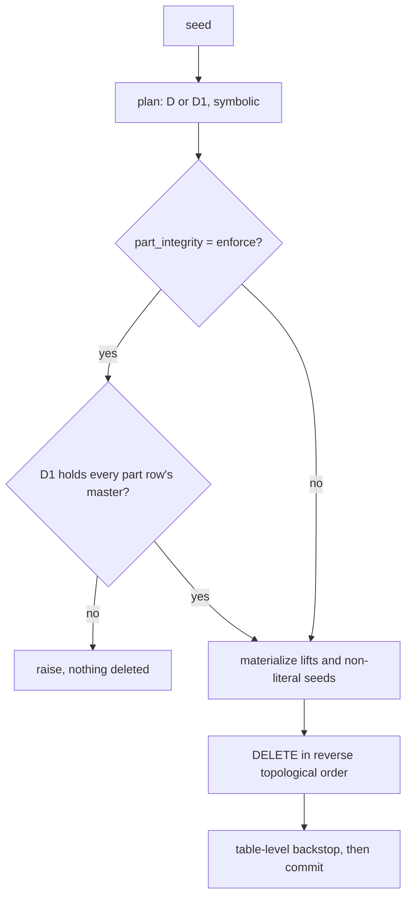

# Cascade Specification

A cascade starts at a restricted **seed** table and deletes, together with the seed's rows, every row that depends on them, in an order the database accepts. It is the `down` case of `Diagram.expand`: the rows it selects are defined once, in the [Diagram specification's Operations](diagram.md#operations), and computed by the rules in [Computation](diagram.md#computation). This page specifies how `Table.delete()` and its preview, `Diagram.cascade()`, use those rows.

For the user-facing entry points, see [Delete Data](../../how-to/delete-data.md). For dependent concepts, see [Master-Part](master-part.md), [Diagram](diagram.md), and [Data Manipulation](data-manipulation.md).

## Entry points

- `Table.delete(part_integrity=...)` deletes the rows.
- `Diagram.cascade(table_expr, part_integrity=...)` holds the same rows without deleting them, for `counts()`, iteration, `d[T]`, and display.

Both compute the same rows from the same plan; only the last step differs.

## Dependency graph

DataJoint loads its foreign-key structure into a directed acyclic graph (`Connection.dependencies`, a `networkx.MultiDiGraph`, so that parallel foreign keys, including renamed ones, are each their own edge). The graph encodes:

| Element | Encodes |
|---|---|
| **Node** | A table, named by its fully-qualified SQL identifier (e.g. ``` `schema`.`table_name` ```). The graph stores the table's primary key set as node data. |
| **Edge `parent -> child`** | A foreign key from `child` to `parent`. Edge data: `attr_map` (dict mapping the child's foreign-key columns to the parent's referenced columns), `aliased` (true if any column was renamed), `primary` (true if the foreign key is in the child's primary key). |
| **Parallel edges** | A child can reference the same parent through more than one foreign key, for example through two renamed (`.proj()`) references. Each is its own edge with its own `attr_map`, `aliased`, and `primary`. |

`Diagram.cascade()` first calls `dependencies.load_all_downstream()`, which adds every schema that references a loaded schema through foreign keys, including schemas the current process has not activated ([X1](traversal-shapes.md#x1-unloaded-downstream-schema)).

## What a cascade deletes

`S` is the set of rows the seed selects. `D(S)` is the closure of `S` under foreign-key children and master-part instances; `D1(S)` is the closure under foreign-key children alone ([definitions](diagram.md#operations)).

| `part_integrity` | Deletes |
|---|---|
| `"cascade"` | `D(S)`. Whichever member of a master-part group the cascade reaches, the whole instance goes: a reached part row lifts to its master, and the master brings all its part rows. |
| `"ignore"` | `D1(S)`. Masters and parts are treated as plain tables, so a part row can be deleted while its master and sibling part rows stay. The caller is responsible for the consequences. |
| `"enforce"` (default) | `D1(S)`, if it contains the master of every part row in it. Otherwise `delete()` raises `DataJointError` **before deleting anything**, naming a part row and its master. |

By [T7](diagram.md#derived-results), `enforce` deletes exactly when `D1(S) = D(S)`, that is, when the group rule would add nothing; in that case `"enforce"` and `"cascade"` delete the same rows.

!!! version-changed "Changed in 2.4"
    - `"enforce"` is checked per part row, before the delete. In 2.3 it was a table-level check after the delete, which could miss an orphaned part row when an unrelated master row was deleted in the same cascade. The 2.4 check is stricter.
    - With `"cascade"`, a master joins the delete only if one of its part rows did. In 2.3 the part's condition was copied to the master, which could delete masters that had no matching part row ([#1591](https://github.com/datajoint/datajoint-python/issues/1591); [G1](traversal-shapes.md#g1-part-to-master-lift)).
    - A downward copy of a condition across a nullable foreign key could delete rows whose foreign key references nothing, and in a diamond it could miss rows ([#1590](https://github.com/datajoint/datajoint-python/issues/1590); [S3](traversal-shapes.md#s3-nullable-foreign-key-sharing-a-primary-key-column), [S7](traversal-shapes.md#s7-diamond-reached-through-a-secondary-foreign-key)).
    - A `dj.Top` seed was ignored ([#1589](https://github.com/datajoint/datajoint-python/issues/1589); [K4](traversal-shapes.md#k4-djtop-seed)).
    - A seed restricted by one of its descendants was silently not deleted ([#1496](https://github.com/datajoint/datajoint-python/issues/1496); [K1](traversal-shapes.md#k1-seed-restricted-by-a-descendant)).

`part_integrity` accepts only `"enforce"`, `"ignore"`, or `"cascade"`; any other value raises `ValueError`.

**Parts that violate A1.** The group rule applies to parts whose heading contains the master's primary key under the master's own attribute names ([A1](diagram.md#model-and-assumptions)). A part that holds the master's key only under renamed attributes is traversed as a plain table, with a warning at declaration, in every mode ([G6](traversal-shapes.md#g6-a-part-violating-a1)).

## Preview

`Diagram.cascade(...)` is symbolic. It holds restrictions, not rows, and reads nothing from the database until `counts()`, iteration, or `d[T]` evaluates them. It never materializes keys, with one exception: in a group whose internal foreign key renames the master's key, the master keys are evaluated while the diagram is built ([groups that iterate](diagram.md#groups-that-iterate)).

Its nodes are every table the cascade can reach, including tables with zero matching rows, and `prune()` refuses to remove them: a table empty when the preview is built can gain rows before the delete runs. The counts of a preview equal the counts the delete then removes, unless the data change in between.

## Delete execution

`Table.delete()` runs these steps inside one transaction:

1. **Plan.** Build the `down` plan for the seed, as for the preview.
2. **Check.** With `"enforce"`, check that `D1(S)` contains the master of each of its part rows. If not, raise before any DELETE.
3. **Materialize.** Replace the restrictions that would read an already-emptied table by the literal keys they select (next section).
4. **Delete.** Delete table by table in reverse topological order: leaves first, the seed's table and other ancestors last.
5. **Backstop.** With `"enforce"`, check at the table level that no part rows were deleted without master rows, and roll back otherwise.



With `safemode=True`, `delete()` shows the per-table counts inside the transaction and asks before committing.

## Delete-time materialization

Downward expansion for a delete carries a constraint that the preview does not: a table's restriction must not read a table that is deleted before it, or the table itself.

`Table.delete()` deletes in reverse topological order, so every downstream table is emptied before the tables it depends on. A restriction that still read a downstream table when its own DELETE ran would match nothing, and the rows it should delete would stay. This happens when the seed is restricted by one of its descendants ([K1](traversal-shapes.md#k1-seed-restricted-by-a-descendant)) or by its own table ([K2](traversal-shapes.md#k2-self-referencing-seed)), and for every part-to-master lift, since a part is deleted before its master.

Before the first DELETE, the engine therefore materializes each restriction whose *local* terms read a table deleted no later than its own: every lift, and every seed whose restriction is not already literal keys. Terms inherited from a parent are safe, because the parent is deleted after its children. Large key sets are applied in chunks. The full rule is in [Materialization happens only at delete time](diagram.md#materialization-happens-only-at-delete-time).

The rule follows from the delete order and applies on every backend. MySQL also rejects a DELETE whose subquery reads the table being deleted (error 1093), and PostgreSQL permits it; materializing first avoids both the stranded rows and the error.

## Concurrency

Part rows are deleted as `part & (restricted master keys)`, with the master's keys materialized. If another session inserts a part row for one of those masters after the part DELETE, the master's DELETE fails on the part's foreign key (`ON DELETE RESTRICT`), the transaction rolls back, and no part row is left without its master. A foreign-key error during a cascade reports two likely causes: a row inserted concurrently, or a downstream schema the connection cannot see.

## Worked example: a seed restricted by a descendant

With the [K1](traversal-shapes.md#k1-seed-restricted-by-a-descendant) schema, the seed `Subject & (Session & "quality = 0")` selects subjects 1 and 2.

1. **Plan.** `Subject` holds the seed. `Session` holds `Session & Subject_restricted.proj()`, and so on down: `Trial` and `Flag`.
2. **Materialize.** The seed reads `Session`, which is deleted before `Subject`, so it is replaced by the keys of subjects 1 and 2. The other restrictions are inherited from parents and stay symbolic.
3. **Delete.** `Trial`, `Flag`, and `Session` rows of subjects 1 and 2 are deleted first, then `Subject` rows 1 and 2.

Without step 2, the DELETE on `Subject` would run after the sessions of quality 0 were gone, match nothing, and leave subjects 1 and 2 in place ([#1496](https://github.com/datajoint/datajoint-python/issues/1496)).

The [Traversal Shape Catalog](traversal-shapes.md) gives the rows for the other shapes: lifts ([G1](traversal-shapes.md#g1-part-to-master-lift)), part-of-part chains ([G2](traversal-shapes.md#g2-part-of-part-with-two-chains)), a second foreign key to the master ([G3](traversal-shapes.md#g3-a-second-renamed-foreign-key-to-its-own-master)), chained instances ([G4](traversal-shapes.md#g4-renamed-sibling-foreign-key-chained-across-three-instances)), and merge tables ([G5](traversal-shapes.md#g5-merge-table)).

## Limitations

- **Materialization memory.** Materialized keys are held in memory, one key per selected row of a lifted master or a materialized seed. Large key sets are applied in chunks.
- **Zero-row nodes.** A table the cascade can reach but whose restriction selects nothing appears with a count of 0 in `counts()` and in iteration. This is by design.

## What is not part of this specification

- **`Diagram.trace()`**: the `up` case of the same traversal; see the [Upstream Trace Specification](trace.md).
- **Custom propagation rules**: not supported. The edge rule and the group rule cover every case the foreign-key graph can produce.

## References

- Source: `src/datajoint/diagram.py` (`Diagram.expand`, `Diagram.cascade`), `src/datajoint/dependencies.py` (dependency graph, `topo_sort`, `extract_master`).
- Issues: [#1429](https://github.com/datajoint/datajoint-python/issues/1429) (part-to-master lift with renamed foreign keys and part-of-part chains), [#1496](https://github.com/datajoint/datajoint-python/issues/1496) (delete-time materialization), [#1589](https://github.com/datajoint/datajoint-python/issues/1589), [#1590](https://github.com/datajoint/datajoint-python/issues/1590), [#1591](https://github.com/datajoint/datajoint-python/issues/1591) (rows deleted outside the cascade).
- [Diagram Specification](diagram.md#traversal-specification) — the definitions of `D`, `D1`, and the computation.
- [Traversal Shape Catalog](traversal-shapes.md) — worked examples.
- [Master-Part Specification](master-part.md) — the master-part contract.
- [Data Manipulation Specification](data-manipulation.md) — `delete()` and `delete_quick()`.
