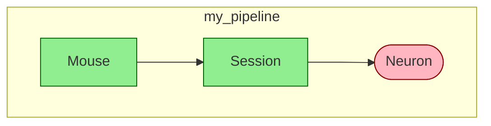

# Diagram Specification

Schema visualization as directed acyclic graphs, and traversal of the rows they connect.

## Overview

`dj.Diagram` visualizes DataJoint schemas as directed graphs showing tables and their foreign key relationships. It provides multiple output formats including SVG, PNG, and Mermaid syntax. It also computes, for a restricted table, the rows that depend on it or that it depends on: the rows a delete must remove, the inputs of a `make()`, or a self-contained export.

## Design Principles

1. **Multiple output formats**: Graphviz (SVG/PNG) and Mermaid for different use cases
2. **Graph algebra**: Combine and filter diagrams with set operators
3. **Visual encoding**: Table tiers distinguished by shape and color
4. **Flexible layout**: Configurable direction and schema grouping
5. **One traversal**: `cascade` and `trace` are the two directions of `expand`, defined once in the [Traversal specification](#traversal-specification)

---

## API Reference

### Constructor

```python
dj.Diagram(source, context=None)
```

| Parameter | Type | Default | Description |
|-----------|------|---------|-------------|
| `source` | Table, Schema, module | — | Source to visualize |
| `context` | dict | None | Namespace for class name resolution |

### Layout Direction

!!! version-added "New in 2.1"
    Configurable layout direction was added in DataJoint 2.1.

Layout direction is controlled via configuration:

```python
# Check current direction
dj.config.display.diagram_direction  # "TB" or "LR"

# Set globally
dj.config.display.diagram_direction = "LR"

# Override temporarily
with dj.config.override(display__diagram_direction="LR"):
    dj.Diagram(schema).draw()
```

| Value | Description |
|-------|-------------|
| `"TB"` | Top to bottom (default) |
| `"LR"` | Left to right |

### Class Method

```python
dj.Diagram.from_sequence(sequence)
```

Create a combined diagram from multiple sources. Equivalent to `Diagram(a) + Diagram(b) + ...`.

---

## Operators

Diagrams support set algebra for combining and filtering:

| Operator | Description | Example |
|----------|-------------|---------|
| `diag + n` | Expand n levels downstream (children) | `dj.Diagram(Mouse) + 2` |
| `diag - n` | Expand n levels upstream (parents) | `dj.Diagram(Neuron) - 2` |
| `diag1 + diag2` | Union of two diagrams | `dj.Diagram(Mouse) + dj.Diagram(Session)` |
| `diag1 - diag2` | Difference (remove nodes) | `dj.Diagram(schema) - dj.Diagram(Lookup)` |
| `diag1 * diag2` | Intersection | `dj.Diagram(schema1) * dj.Diagram(schema2)` |

### Common Patterns

```python
# Show table with immediate parents and children
dj.Diagram(MyTable) + 1 - 1

# Show entire schema
dj.Diagram(schema)

# Show all tables downstream of a source
dj.Diagram(SourceTable) + 10

# Show ancestry of a computed table
dj.Diagram(ComputedTable) - 10
```

**Note:** Order matters. `diagram + 1 - 1` may differ from `diagram - 1 + 1`.

!!! version-added "New in 2.4"
    On a diagram returned by `expand()`, `cascade()`, or `trace()`, only `d1 + d2` of two diagrams with the same direction is defined; the other operators raise. See [Expanded diagrams](#expanded-diagrams).

### Collapsing Schemas

!!! version-added "New in 2.1"
    The `collapse()` method was added in DataJoint 2.1.

```python
diag.collapse()
```

Mark a diagram for collapsing when combined with other diagrams. Collapsed schemas appear as single nodes showing the table count.

```python
# Show schema1 expanded, schema2 as a single collapsed node
dj.Diagram(schema1) + dj.Diagram(schema2).collapse()
```

**"Expanded wins" rule:** If a node appears in both a collapsed and non-collapsed diagram, it stays expanded. This allows you to show specific tables from a schema while collapsing the rest.

```python
# Subject is expanded, rest of analysis schema is collapsed
dj.Diagram(Subject) + dj.Diagram(analysis).collapse()
```

---

## Operational Methods

!!! version-added "New in 2.2"
    Operational methods (`Diagram.cascade()`, `restrict`, `counts`, `prune`) were added in DataJoint 2.2.

!!! version-added "New in 2.4"
    `Diagram.expand()` is the one traversal behind `cascade()` and `trace()`. Its rows are defined in the [Traversal specification](#traversal-specification) below.

A diagram can compute, for a restricted table, the rows a delete must remove, the rows a `make()` may read, or the rows an export must carry. The methods in this section compute and inspect those rows without changing any data. `Table.delete()` and `Table.drop()` use them internally and carry out the mutation.

### `Diagram.expand()` (class method)

```python
dj.Diagram.expand(seed, direction="down")
```

| Parameter | Type | Default | Description |
|-----------|------|---------|-------------|
| `seed` | QueryExpression | — | One table with any restriction (see [Seeds](#seeds)) |
| `direction` | str | `"down"` | `"down"`, `"up"`, or `"both"` |

**Returns:** a `Diagram` whose nodes are the tables the expansion reaches, each holding the rows of that table in the expansion.

| `direction` | Rows | Used for |
|---|---|---|
| `"down"` | `D(S)`: the seed rows and every row that depends on them | delete, impact analysis |
| `"up"` | `U(S)`: the seed rows and every row they depend on | the inputs of `make()`, lineage |
| `"both"` | `U(D(S))`: a region around the seed that is consistent on its own | export |

`S` is the set of rows the seed selects. `D`, `U`, and `U(D(S))` are defined under [Operations](#operations).

```python
# Every row that depends on subject 1, by table
dj.Diagram.expand(Subject & {"subject_id": 1}, "down").counts()

# Everything a selected session was derived from
dj.Diagram.expand(Session & {"subject_id": 1, "session_id": 2}, "up")[Subject]
```

### `Diagram.cascade()` (class method)

```python
dj.Diagram.cascade(table_expr, part_integrity="enforce")
```

The preview of `(table_expr).delete(part_integrity=...)`. It loads every schema downstream of the seed and holds the rows the delete would remove.

| Parameter | Type | Default | Description |
|-----------|------|---------|-------------|
| `table_expr` | QueryExpression | — | The seed, e.g. `Session & {"subject_id": 1}` |
| `part_integrity` | str | `"enforce"` | Master-part integrity policy |

| `part_integrity` | Rows |
|---|---|
| `"cascade"` | `D(S)`, the same rows as `expand(table_expr, "down")` |
| `"ignore"` | `D1(S)`: the rows reached through foreign keys alone, with part tables treated as plain tables |
| `"enforce"` (default) | `D1(S)`. `Table.delete()` deletes these rows only if they include the master of every part row among them, and otherwise raises before deleting anything |

With `"enforce"`, the preview holds `D1(S)` and does not raise; the check runs in `Table.delete()`. `part_integrity` accepts only `"enforce"`, `"ignore"`, or `"cascade"`; any other value raises `ValueError`. The [Cascade Specification](cascade.md) covers the delete itself.

!!! version-changed "Changed in 2.4"
    `"enforce"` checks each part row's own master, before any row is deleted. In 2.3 it was a table-level check run after the delete. With `"cascade"`, a master joins the delete only if one of its part rows did ([#1591](https://github.com/datajoint/datajoint-python/issues/1591)).

```python
# Preview the impact of a delete across all loaded schemas
dj.Diagram.cascade(Session & {"subject_id": 1}).counts()
```

### `Diagram.trace()` (class method)

```python
dj.Diagram.trace(table_expr)
```

The rows `table_expr` depends on: `U(S)`, the same rows as `expand(table_expr, "up")`. It loads every schema upstream of the seed. The [Upstream Trace Specification](trace.md) covers its use and `self.upstream`, the per-`make()` instance of a trace.

```python
trace = dj.Diagram.trace(MyChild & key)
trace[Session].fetch1("session_date")
```

!!! version-changed "Changed in 2.4"
    A trace includes all parts of every master it reaches, and the ancestors of those parts ([#1481](https://github.com/datajoint/datajoint-python/issues/1481)). In 2.3 it included a part only if the part lay on a foreign-key path to the seed.

### Indexing: `d[T]`

```python
d[Session]                  # a Table class or instance
d["Session"]               # a class name, or a full table name
```

Returns table `T` restricted to its rows in the expansion, as a query expression, in every direction. It raises `DataJointError` if `T` is not a node of the diagram. A node can hold zero rows; indexing it returns an empty expression.

!!! version-changed "Changed in 2.4"
    In 2.3, indexing worked only on diagrams returned by `trace()`.

### `counts()`

```python
diag.counts()
```

Returns the number of rows each node holds, without modifying data.

**Returns:** `dict[str, int]` — full table name to row count. Tables in the diagram with no rows map to 0.

```python
counts = dj.Diagram.cascade(Session & {"subject_id": 1}).counts()
# {'`lab`.`session`': 3, '`lab`.`trial`': 45, '`lab`.`processed_data`': 45}
```

### `prune()`

```python
diag.prune()
```

Removes the nodes that hold zero rows from the diagram. No table or data is modified. On a diagram that was not expanded, it removes physically empty tables.

**Constraints:** `prune()` raises on a `down` diagram, including any diagram returned by `cascade()`. A delete must keep every table it reaches, because a table that is empty when the diagram is built can gain rows before the delete runs. `prune()` is allowed on `up` and `both` diagrams.

```python
# Export region around one subject, without empty tables
region = dj.Diagram.expand(Subject & {"subject_id": 1}, "both").prune()
region.counts()
region             # display the region
```

### Iteration

Diagrams support iteration in topological order:

| Method | Order | Use Case |
|--------|-------|----------|
| `for ft in diagram` | Parents first | Data export, inspection |
| `for ft in reversed(diagram)` | Leaves first | Cascade delete, drop |

Each iteration yields a `FreeTable` restricted to the node's rows. Only nodes in the diagram's visible set (`nodes_to_show`) are yielded.

`Table.delete()` and `Table.drop()` use `reversed(diagram)` internally to execute mutations in safe dependency order.

### `restrict()`

!!! version-deprecated "Deprecated in 2.4, removed in 3.0"
    `Diagram.restrict()` emits a `DeprecationWarning`. Its behavior is frozen. Use `Diagram.expand()`; see [Retiring `restrict`](#retiring-restrict) for the migration.

```python
diag.restrict(table_expr)
```

Restricts a full diagram for export: the restriction propagates downstream, and where several restricted ancestors meet, a row is kept only if it matches all of them (AND). The full diagram is preserved, including ancestors and unrelated tables, so `restrict()` can be chained from other seeds. It cannot be called on a diagram produced by `cascade()`.

### Unloaded schemas

`expand()`, `cascade()`, and `trace()` first load every schema reachable through foreign keys in the direction of travel, including schemas the current process has not activated ([X1](traversal-shapes.md#x1-unloaded-downstream-schema)). If a delete still fails with a foreign-key error, DataJoint names the two likely causes: a downstream schema the connection cannot see, or a row inserted concurrently.

---

## Traversal specification

!!! version-added "New in 2.4"
    This section is the normative definition of `Diagram.expand()`, `cascade()`, and `trace()`. The test suite checks the engine against an executable copy of these definitions, and the [Traversal Shape Catalog](traversal-shapes.md) works through one example per schema shape.

The definitions are about rows; the computation is about tables and restrictions.

### Base principles

- **P1, referential integrity.** Every foreign-key value names an existing parent row.
- **P2, compositional integrity.** A master row and its part rows are one entity. They are inserted together and deleted together.
- **P3, reproducibility.** `make(key)` reads only rows that `key` depends on.
- **P4, minimality.** An operation touches no row it does not have to.

### Model and assumptions

**Foreign-key references.** A foreign key `e` of a child table `C` references a parent table `P`. Its attribute map `attr_map_e` pairs attributes of `C` with the primary-key attributes of `P`; the names differ when the declaration renames them with `.proj()`. For a row `c` of `C`, `ref_e(c)` is the row of `P` whose primary key equals `c`'s values on those attributes. By P1, that row exists.

**A2, NULLs.** If any of `c`'s attributes in `e` is NULL, `ref_e(c)` is undefined: `c` references nothing through `e`. This is SQL's MATCH SIMPLE rule, which both supported backends apply: a foreign key with a NULL column is not checked. Foreign keys can share columns ([S3](traversal-shapes.md#s3-nullable-foreign-key-sharing-a-primary-key-column)), so a row can have some columns of a foreign key set and others NULL. Such a row still references nothing through that foreign key.

**Parallel foreign keys.** Two foreign keys between the same pair of tables are separate references, each with its own `attr_map` ([S5](traversal-shapes.md#s5-parallel-foreign-keys)).

**A1, owned parts.** A part is **owned** by its master if a foreign key in the part's primary key references the master, or references an owned part of the same master. A foreign key is in the primary key when all its attributes are primary-key attributes of the part, wherever the reference is declared. The references along this chain may rename attributes. A foreign key in the primary key cannot be NULL, so every row of an owned part references a row at each step of the chain. A master and its owned parts form the master's **group**.

The **owning attributes** of an owned part are the part's attributes that the chain maps onto the master's primary key:

- for `-> master` in the primary key, the master's own key attributes;
- for `-> master.proj(m_id="master_id")`, the attribute `m_id`;
- for a reference to an owned part, the attributes that the reference maps onto that part's owning attributes ([G7](traversal-shapes.md#g7-owned-part-of-part-with-renamed-attributes)).

If a part has several owning chains, its owning attributes come from an unrenamed `-> master` if it has one, and otherwise from the first owning reference in its definition.

For a row `r` of an owned part:

- `master(r)` is the master row whose primary key equals `r`'s owning attributes;
- `inst(r)`, the **instance** of `r`, is `master(r)` together with every row of every owned part of the same master whose owning attributes have the same values.

For a master row `m`, `inst(m)` is `m` together with the rows of its owned parts whose owning attributes equal `m`'s key. For any other row `r`, `inst(r) = {r}`.

A part that is not owned gets a warning at declaration, and it is a plain table in traversal, in `topo_sort`, and in the declaration check: it has no master and no instance. This covers a part that does not reference its master, one that references it only through a foreign key with attributes outside the primary key (a secondary or nullable reference), and one that references it only through a part that is not owned ([G6](traversal-shapes.md#g6-a-part-its-master-does-not-own)).

!!! version-added "New in 2.4"
    Ownership decides which parts belong to a master's group ([#1619](https://github.com/datajoint/datajoint-python/issues/1619)). In 2.3, every part was grouped with its master by its table name.

**Row relations.** For a row `r`:

- `child(r) = {c : ref_e(c) = r for some foreign key e}` — the rows that reference `r`;
- `parent(r) = {ref_e(r) : e a foreign key of r's table, ref_e(r) defined}` — the rows `r` references;
- `down(r) = child(r) ∪ inst(r)`;
- `up(r) = parent(r) ∪ inst(r)`.

`up` is exactly the converse of `down`: `y ∈ down(x)` if and only if `x ∈ up(y)`. `parent` is the converse of `child`, and sharing an instance is symmetric.

### Operations

A set of rows `X` is **closed under** a relation `R` when, for every row `x` in `X`, all of `R(x)` is in `X` too. The **closure** of a set `S` under `R` is the smallest set that contains `S` and is closed under `R`. It is computed by starting from `S` and adding `R`-neighbors until nothing new appears; in mathematical terms it is the *least fixed point* of that step. Every closure here is finite because the database is.

Let `S` be the set of rows the seed selects. Then:

- `D(S)` is the closure of `S` under `down`;
- `U(S)` is the closure of `S` under `up`;
- `D1(S)` is the closure of `S` under `child` alone, with no instance step.

| Call | Rows |
|---|---|
| `expand(seed, "down")` | `D(S)` |
| `expand(seed, "up")` | `U(S)` |
| `expand(seed, "both")` | `U(D(S))` |

**Why `both` is `U(D(S))`.** An export region must be importable on its own: every foreign key in it must resolve inside it, and every instance in it must be whole. `U(D(S))` is the smallest such region that contains everything derived from `S` (T6). The other two combinations fail:

- `D(U(S))` adds every descendant of every ancestor. For a seed under a shared lookup table, that is most of the database.
- `D(S) ∪ U(S)` misses the other parents of the descendants. In [S5](traversal-shapes.md#s5-parallel-foreign-keys), exporting neuron 1 this way would carry synapse (3, 1) without neuron 3.

**Delete.** `Table.delete(part_integrity=...)` and its preview `Diagram.cascade()`:

| `part_integrity` | Deletes |
|---|---|
| `"cascade"` | `D(S)` |
| `"ignore"` | `D1(S)`. A part row can be deleted while its master and sibling part rows stay. |
| `"enforce"` (default) | `D1(S)`, if it is **lift-closed**: it contains `master(r)` for every part row `r` in it. Otherwise it raises **before deleting anything**, naming a part row and its master. |

By T7, `enforce` deletes `D(S)` when the group rule would add nothing to `D1(S)`, and refuses otherwise.

**Trace.** `Diagram.trace(seed)` selects `U(S)`.

**`self.upstream`.** `make(key)` runs before the row for `key` is inserted, so `self & key` selects nothing, and `U(∅) = ∅` would leave `self.upstream` empty. `self.upstream` therefore starts from the parents that row will have. For each foreign key `e` of the table that lies in its primary key, `relabel_e(key)` renames `key`'s values onto the primary key of the parent `P_e` through `attr_map_e`, and

```
self.upstream = ⋃ over primary foreign keys e of  expand(P_e & relabel_e(key), "up")
```

Foreign keys outside the primary key are left out: their values are not known before the insert. By T2, `self.upstream` is `U` of the parents of the row being computed.

!!! version-changed "Changed in 2.4"
    In 2.3, `self.upstream` was `Diagram.trace(self & key)`. It returned the parents only because the engine copied the key's condition upward, which is not sound for other seeds (see [R1](#r1-the-edge-rule)).

### Derived results

Each result below follows from the definitions and is checked by the test suite.

**T1, closure.** `D`, `U`, and `D1` are *extensive* (`X(S) ⊇ S`), *monotone* (`A ⊆ B` implies `X(A) ⊆ X(B)`), and *idempotent* (`X(X(S)) = X(S)`).

Every closure under a relation has these properties: the result contains `S` by construction, a larger starting set reaches at least the same rows, and a set that is already closed gains nothing from closing it again.

**T2, additivity.** `X(A ∪ B) = X(A) ∪ X(B)` for `X` = `D`, `U`, `D1`, and for `both`.

Each step adds the neighbors of a single row, so a row is in `X(S)` exactly when a chain of steps leads to it from one row of `S`, and that is the case for `A ∪ B` exactly when it is the case for `A` or for `B`. For `both`, `U(D(A ∪ B)) = U(D(A) ∪ D(B)) = U(D(A)) ∪ U(D(B))`. So several seeds give the union of their expansions: `expand` never needs an intersection, `d1 + d2` of the same direction is exact, and `self.upstream` is built as a union.

**T3, duality.** `y ∈ D({x})` if and only if `x ∈ U({y})`.

A chain of `down` steps from `x` to `y`, read backwards, is a chain of `up` steps from `y` to `x`, because `up` is the converse of `down`. So deleting `x` invalidates exactly the rows whose upstream contains `x`. Because a delete lifts part rows to their master, a trace must include the parts of an ancestor master, and their ancestors ([#1481](https://github.com/datajoint/datajoint-python/issues/1481); [G5](traversal-shapes.md#g5-merge-table)). `ignore`'s `D1` is likewise dual to a trace without the instance step.

**T4, delete safety.** If the database satisfies P1, removing `D(S)` keeps P1 and removes each instance either whole or not at all (P2). `D(S)` is the smallest superset of `S` with both properties (P4).

`D(S)` contains every child of every row in it, so no remaining row references a removed one; and it contains the instance of every row in it, so no instance is split. Conversely, a removed set `X ⊇ S` that keeps P1 must contain the children of its rows, and one that keeps instances whole must contain their instances. Such an `X` is closed under `down` and so contains `D(S)`.

**T5, read boundary.** `U(S)` is consistent on its own: every foreign key of its rows resolves inside it, and every instance in it is whole. It is the smallest superset of `S` with that property, and so the set of rows `S` depends on (P3).

The argument is T4's with `parent` in place of `child`.

**T6, `both`.** `U(D(S))` contains `D(S)`, is closed under `up`, and so is consistent on its own and contains every instance it touches. It is the smallest set with these properties that contains `D(S)`. `both` is extensive and monotone but not idempotent.

`U(D(S))` is `U` of `D(S)`, so T5 applies to it with `D(S)` as the seed. For non-idempotence, take a table `A` with two child tables `B` and `C`, and a row `a` with one child `b` in `B` and one child `c` in `C`. With `S = {b}`, `both(S) = U({b}) = {a, b}`, and `both({a, b}) = U({a, b, c}) = {a, b, c}`: the second application picks up `a`'s other descendant.

**T7, enforce.** `D1(S)` is lift-closed if and only if `D1(S) = D(S)`.

Every row of an owned part can be reached from its master row by `child` steps along its owning chain: each reference in the chain lies in a primary key, so it is never NULL, and it maps owning attributes onto owning attributes, so it stays in the same instance. So if `D1(S)` contains the master of each of its part rows, it contains their whole instances, is closed under `down`, and equals `D(S)`. Conversely, `D(S)` is closed under `inst`, so if `D1(S) = D(S)` it is lift-closed. `enforce` therefore deletes only when the group rule would add nothing.

**T8, ordering.** `topo_sort` succeeds if and only if the group quotient `Q` is acyclic. The **group quotient** `Q` is the table-level foreign-key graph with each master and its owned parts merged into a single node; a part that is not owned stays a node of its own.

`topo_sort` keeps each owned part right after its master, so it sorts the table graph after adding, for each owned part, an edge from each of the part's parents outside its group to its master. The master reaches each owned part along its owning chain, so a cycle in `Q` becomes a cycle in that graph. Conversely, a cycle in that graph cannot stay inside one group, because foreign keys between tables never form a cycle, so it maps to a cycle in `Q`.

The declaration check keeps `Q` acyclic ([#1619](https://github.com/datajoint/datajoint-python/issues/1619); [X2](traversal-shapes.md#x2-group-cycle-refused-at-declaration)). An owned part may reference its master, an owned part of the same master, or a table that does not depend on its master, with groups taken whole; parts the master does not own count as outside the group. A reference to any other table would close a cycle in `Q`, and the declaration is refused before any table is created.

### Computation

The engine computes the rows above as restrictions on tables, without reading the rows, except where noted.

#### R1, the edge rule

**Down.** Crossing a foreign key `e` from a restricted parent `P` to the child `C`, the child is restricted by the restricted parent, projected onto `P`'s primary key, with each key attribute renamed to its name in `C` through `attr_map_e`:

```
C & P_restricted.proj(<P's key attributes, renamed to their names in C>)
```

The parent's condition may instead be **copied** to the child unchanged, but only when the attributes it names are among `e`'s attributes, `e` is not renamed, and none of `e`'s columns is nullable. Here, the attributes a condition names are every key of a dict, including keys that are not attributes of the parent, and the whole heading of a query expression. Under these conditions each child row holds the same values under the same names as the parent row it references, and it references one, so the copied condition selects exactly the children. [S3](traversal-shapes.md#s3-nullable-foreign-key-sharing-a-primary-key-column) shows the nullable case, [S4](traversal-shapes.md#s4-renamed-foreign-key) the renamed case, and [S7](traversal-shapes.md#s7-diamond-reached-through-a-secondary-foreign-key) a condition on an attribute the child holds through a different parent.

A copy is a shortcut, and it must select the same rows as the restriction. Two kinds of condition would change meaning if moved, and the rule above already keeps them from being copied:

- a dict with keys that are not attributes of the parent: they are ignored on the parent but can match attributes of the child;
- a query expression that shares more attributes with the child than with the parent: a restriction by a query expression matches on all shared attributes. Copied to `Session`, the seed condition of [K1](traversal-shapes.md#k1-seed-restricted-by-a-descendant), `Session & "quality = 0"`, would match on every attribute of `Session` and select only the sessions of quality 0. Copied the same way, the seed `Subject - (Session & "quality = 0")` would select every session of another quality, including sessions of subjects that are not deleted.

!!! note
    The 2.3 engine copies the compiled SQL predicate, which reads only the parent's columns. That is why 2.3 copies dict conditions, and conditions given as query expressions, correctly. (A seed restricted by a query expression failed in 2.3 for a different reason, before any copy; 2.3.5 replaces such a seed by its keys, [#1610](https://github.com/datajoint/datajoint-python/issues/1610).) The 2.4 plan refers to conditions rather than to compiled SQL, so the rule above applies.

**Parallel foreign keys** combine with OR: a child row is reached if any of its foreign keys references a restricted row.

**Up.** Crossing `e` from a restricted child `C` to the parent `P` is always the restriction

```
P & C_restricted.proj(<e's attributes in C, renamed to their names in P>)
```

This selects the parent rows referenced by at least one restricted child row. It is never a copy: a condition on the child describes child rows, and copied to the parent it would select parents that no restricted child references ([S2](traversal-shapes.md#s2-secondary-foreign-key), [S3](traversal-shapes.md#s3-nullable-foreign-key-sharing-a-primary-key-column)).

The one shortcut upward applies to keys materialized from the child table itself (for example `(C & cond).keys()`) that include every column of `e`: these may be relabeled through `attr_map_e`. They name existing child rows, so the relabeled keys name exactly the referenced parents. A user-supplied key dict may name rows that do not exist, so it crosses upward by restriction too ([K5](traversal-shapes.md#k5-empty-seeds)).

#### R2, the group rule

For a master `M` and its part `Pi`, with `R(T)` the restriction on table `T`:

- **lift:** `M & R(Pi).proj(m1="o1", m2="o2", …)` — the masters of the restricted part rows. Each owning attribute `o` of `Pi` is renamed to the attribute `m` of the master's key that it maps onto; for an unrenamed `-> master` this is `M & R(Pi).proj()`. Every owned part row holds its owning attributes, so the lift is one step, with no walk along the foreign keys between parts ([G2](traversal-shapes.md#g2-part-of-part-with-two-chains), [G7](traversal-shapes.md#g7-owned-part-of-part-with-renamed-attributes)). The part's other references to its master are not used for the lift ([G3](traversal-shapes.md#g3-a-second-renamed-foreign-key-to-its-own-master)).
- **re-expand:** `Pi & R(M)` — every part row of the restricted masters.

The lift is existential: a master joins only if at least one of its part rows did ([G1](traversal-shapes.md#g1-part-to-master-lift)).

#### One pass over the group quotient

Because `Q` is acyclic (T8), the engine visits each node of `Q` once: in `topo_sort` order for `down`, and in reverse order for `up`.

- A **plain table** `T` gets `R(T)` = its seed ∪ R1 from each restricted neighbor on the incoming side (its parents for `down`, its children for `up`).
- A **group** with master `M` gets `R(M)` = the seed on `M` ∪ R1 into `M` ∪ lift(R1 into each part ∪ the seed on each part). Then each part `Pi` gets `Pi & R(M)`.

`up` is the same pass with every edge reversed. The pass is exact because every neighbor on the incoming side is final before it is used (`Q` is acyclic), and because every foreign key inside a group maps owning attributes onto owning attributes, so steps inside a group never leave the instances already in `R(M)`. The next subsection covers the groups where that fails.

#### Groups that iterate

A group iterates if and only if some foreign key inside it does not map the referencing part's owning attributes onto the referenced table's owning attributes (for the master, its primary key). Such a foreign key links different instances of the group. In [G4](traversal-shapes.md#g4-renamed-sibling-foreign-key-chained-across-three-instances), a `Carry` row of run 2 references a `Step` row of run 1 through `prev_run`, which is not an owning attribute of `Carry`; in [G3](traversal-shapes.md#g3-a-second-renamed-foreign-key-to-its-own-master), a part references another row of its own master through `other_session`. Renaming the master's key is one way this happens. A foreign key references the whole primary key, which contains the referenced table's owning attributes, so every reference inside a group carries a master key; the question is only whether it is the referencing part's own.

The engine detects such a foreign key from its `attr_map`. For that group only, it evaluates the lifted master keys and repeats the group step until no new key appears. This is the only place where a traversal reads rows before a delete.

#### Seeds

- A seed is one table with any restriction. Projections, joins, aggregations, and unions are refused as seeds. The restriction itself may use them, for example a subquery on a descendant ([K1](traversal-shapes.md#k1-seed-restricted-by-a-descendant)) or on the seed's own table ([K2](traversal-shapes.md#k2-self-referencing-seed)).
- A `dj.Top` seed is first replaced by the primary keys it selects ([K4](traversal-shapes.md#k4-djtop-seed)).
- A dict that names none of the table's attributes means all rows, as in any restriction ([Query Algebra §2.4](query-algebra.md#24-dictionary-conditions)). As a seed, it raises a warning ([K6](traversal-shapes.md#k6-unrestricted-seed)).
- A materialized seed (a dict, a list of dicts, or `.keys()`) may cross an edge by **relabeling**: keeping only the keys the foreign key carries, renamed through `attr_map`. Relabeling is used only where it selects the same rows as R1. Downward, every key must name, among the parent's attributes, only attributes the foreign key carries; and if the foreign key has a nullable column, every key must name all of the foreign key's attributes, none of them NULL. Otherwise relabeling changes the rows: `Session & {"quality": 0}` relabels to `{}` across `Trial`'s foreign key and would select every trial, and on the schema of [S3](traversal-shapes.md#s3-nullable-foreign-key-sharing-a-primary-key-column), `Surgery & {"subject_id": 1, "surgery_id": None}` selects no surgery but, relabeled, would select session (1, 2; NULL). Upward, relabeling applies only to keys read from the child table that contain all of the foreign key's columns. A live seed — a string or a query expression — crosses by restriction. Both give the same rows ([K3](traversal-shapes.md#k3-seed-kinds-give-the-same-rows)).
- The attributes a string condition names are read from its text outside any subquery.

#### The plan

The engine first builds a **plan**: an intermediate form, not SQL. Its nodes are `Seed`, `Restrict(src, attr_map)`, `Lift(part)`, `Reexpand(master)`, `Or`, and `Literal`. A node refers to the restrictions it uses by a handle to another node; compiled SQL is never copied from one restriction into another. The plan compiles to query expressions for the database. It can also be evaluated against rows held in memory, which is how the test suite compares it with the definitions above.

#### Materialization happens only at delete time

Traversal and preview (`counts()`, iteration, `d[T]`) stay symbolic, apart from [groups that iterate](#groups-that-iterate). Before the first DELETE, the engine **materializes** a node, replacing its restriction by the literal keys it selects, when one of the node's local terms reads a table that is deleted no later than the node itself. A *local term* is the node's seed or a lift into it. The terms a node inherits through R1 from a parent are safe: `Table.delete()` deletes in reverse topological order, so a parent still holds its rows when its children are deleted.

In practice:

- every lift is materialized, because a part is deleted before its master;
- a seed is materialized unless its restriction is literal keys, because a string or query-expression restriction is SQL text whose reads cannot be inspected ([K1](traversal-shapes.md#k1-seed-restricted-by-a-descendant), [K2](traversal-shapes.md#k2-self-referencing-seed));
- large key sets are applied in chunks.

Without this, a restriction that reads a table emptied earlier in the same delete would match nothing, and its rows would stay behind ([#1496](https://github.com/datajoint/datajoint-python/issues/1496)).

#### Concurrency

- Part rows are deleted as `Pi & R(M)`, with `M` materialized. A part row inserted by another session after that DELETE makes the master's DELETE fail on its foreign key (`ON DELETE RESTRICT`), so the transaction rolls back and the part row is never left without its master.
- The foreign-key error message mentions concurrent inserts.
- `enforce` runs the `down` plan once its check passes. By T7, its rows are `D1(S)`.
- The table-level check after the delete stays as a cheap backstop.

### Expanded diagrams

A diagram returned by `expand()`, `cascade()`, or `trace()` is an **expanded diagram**. It has a direction, and it obeys the following contract.

- **Nodes.** The node set is the *table-level reach* of the seed's table: the tables reached by following foreign keys in the direction of travel, together with the master and all owned parts of every group that has a reached member. (For `D1`, the group step is left out.) For `both`, it is the upward reach of the downward reach. A node may hold zero rows.
- **`d[T]`** returns `T` restricted to its rows, in every direction, and raises `DataJointError` if `T` is not a node.
- **`counts()`** works, and **iteration** runs in topological order.
- **Copying** a diagram, `dj.Diagram(d)`, keeps its direction.
- **`d1 + d2`** of two diagrams with the same direction holds, for each table, the union of their rows (T2). It raises for diagrams of different directions, for an expanded diagram and one that is not expanded, and for two `cascade()` diagrams with different `part_integrity` modes.
- **`-`, `*`, `+ n`, and `- n`** raise.
- **`prune()`** raises for `down` and is allowed for `up` and `both`.

!!! version-changed "Changed in 2.4"
    In 2.3, copying a diagram dropped its direction, and `d1 + d2` silently dropped the right operand's restrictions.

### Retiring `restrict`

`Diagram.restrict()` is deprecated in 2.4: it emits a `DeprecationWarning`, its behavior is frozen, and it is removed in 3.0. It intersected the conditions that reached a table (AND), which can split an instance, keeping a master with only some of its parts ([#1501](https://github.com/datajoint/datajoint-python/issues/1501)). `expand` takes unions instead, so its results are larger: they hold everything the seed reaches, and never part of an instance.

| Use of `restrict` | Replacement |
|---|---|
| One condition, for export | `dj.Diagram.expand(Session & cond, "both")` |
| One condition, for impact | `dj.Diagram.expand(Session & cond, "down")` |
| Several conditions that share a descendant | Seed the descendant with all of them, e.g. `dj.Diagram.expand(Session & (Subject & cond_a) & cond_b, "both")` |
| Per-table AND across several seeds | The recipe below |

The recipe intersects, table by table, the rows that separate `down` expansions reach:

```python
seeds = [Subject & {"species": "mouse"}, Session & "session_date > '2024-01-01'"]
carved = {}
for diagram in (dj.Diagram.expand(seed, "down") for seed in seeds):
    for table in diagram:  # restricted FreeTable, parents first
        name = table.full_table_name
        carved[name] = carved[name] & table.proj() if name in carved else table
```

Each `carved[name]` holds the rows that every seed reaching that table reaches. Unlike `restrict`, a single seed's paths combine by union. The result is not closed: it can split an instance and need not be importable on its own, so use it for inspection, and seed a common descendant for export.

The [Traversal Shape Catalog](traversal-shapes.md) gives the exact rows for each schema shape the specification distinguishes.

---

## Output Methods

### Graphviz Output

| Method | Returns | Description |
|--------|---------|-------------|
| `make_svg()` | `IPython.SVG` | SVG for Jupyter display |
| `make_png()` | `BytesIO` | PNG image bytes |
| `make_image()` | `ndarray` | NumPy array (matplotlib) |
| `make_dot()` | `pydot.Dot` | Graphviz DOT object |

### Mermaid Output

!!! version-added "New in 2.1"
    Mermaid output was added in DataJoint 2.1.

```python
make_mermaid() -> str
```

Generates [Mermaid](https://mermaid.js.org/) flowchart syntax for embedding in Markdown, GitHub, or web documentation. Tables are grouped into subgraphs by schema.

### Display Methods

| Method | Description |
|--------|-------------|
| `draw()` | Display with matplotlib |
| `_repr_svg_()` | Jupyter notebook auto-display |

### File Output

```python
save(filename, format=None)
```

| Parameter | Type | Description |
|-----------|------|-------------|
| `filename` | str | Output file path |
| `format` | str | `"png"`, `"svg"`, or `"mermaid"`. Inferred from extension if None. |

**Supported extensions:** `.png`, `.svg`, `.mmd`, `.mermaid`

---

## Visual Encoding

### Table Tiers

Each table tier has a distinct visual style:

| Tier | Shape | Fill Color | Font Color |
|------|-------|------------|------------|
| **Manual** | rectangle | green | dark green |
| **Lookup** | plain text | gray | black |
| **Computed** | ellipse | red | dark red |
| **Imported** | ellipse | blue | dark blue |
| **Part** | plain text | transparent | black |

### Edge Styles

| Style | Meaning |
|-------|---------|
| Solid line | Primary foreign key |
| Dashed line | Non-primary foreign key |
| Thick line | Master-Part relationship |
| Thin line | Multi-valued foreign key |
| Orange line | Renamed foreign key (via `.proj()`) — hover the edge for the column-rename tooltip |

### Node Labels

- **Underlined**: Table introduces new primary key attributes
- **Plain**: Table inherits all primary key attributes from parents

---

## Schema Grouping

!!! version-added "New in 2.1"
    Automatic schema grouping was added in DataJoint 2.1.

Tables are automatically grouped into visual clusters by their database schema. The cluster label shows the Python module name when available (following the DataJoint convention of one module per schema), otherwise the database schema name.

```python
# Multi-schema diagram - tables automatically grouped
combined = dj.Diagram(schema1) + dj.Diagram(schema2)
combined.draw()

# Save with grouping
combined.save("pipeline.svg")
```

This is useful when visualizing multi-schema pipelines to see which tables belong to which module.

---

## Examples

### Basic Usage

```python
import datajoint as dj

# Diagram from a single table
dj.Diagram(Mouse)

# Diagram from entire schema
dj.Diagram(schema)

# Diagram from module
dj.Diagram(my_pipeline_module)
```

### Layout Direction

```python
# Horizontal layout using config override
with dj.config.override(display__diagram_direction="LR"):
    dj.Diagram(schema).draw()

# Or set globally
dj.config.display.diagram_direction = "LR"
dj.Diagram(schema).save("pipeline.svg")
```

### Saving Diagrams

```python
diag = dj.Diagram(schema)

# Save as SVG
diag.save("pipeline.svg")

# Save as PNG
diag.save("pipeline.png")

# Save as Mermaid
diag.save("pipeline.mmd")

# Explicit format
diag.save("output.txt", format="mermaid")
```

### Mermaid Output

```python
print(dj.Diagram(schema).make_mermaid())
```

Output:


### Combining Diagrams

```python
# Union of schemas
combined = dj.Diagram(schema1) + dj.Diagram(schema2)

# Intersection
common = dj.Diagram(schema1) * dj.Diagram(schema2)

# From sequence
combined = dj.Diagram.from_sequence([schema1, schema2, schema3])
```

---

## Dependencies

Operational methods (`expand`, `cascade`, `trace`, `counts`, `prune`) use `networkx`, which is always installed as a core dependency.

Diagram **visualization** requires optional dependencies:

```bash
pip install matplotlib pygraphviz
```

If visualization dependencies are missing, `dj.Diagram` displays a warning and provides a stub class. Operational methods remain available regardless.

---

## See Also

- [How to Read Diagrams](../../how-to/read-diagrams.ipynb)
- [Traversal Shape Catalog](traversal-shapes.md) — Worked examples of `expand`, one per schema shape
- [Cascade Specification](cascade.md) — The delete case of `expand`
- [Upstream Trace Specification](trace.md) — The upstream case of `expand` and `self.upstream`
- [Master-Part](master-part.md) — Master-part groups
- [Delete Data](../../how-to/delete-data.md) — Cascade inspection and delete workflow
- [What's New in 2.2](../../about/whats-new-22.md) — Motivation and design
- [Data Manipulation](data-manipulation.md) — Insert, update, delete specification
- [Query Algebra](query-algebra.md)
- [Table Declaration](table-declaration.md)
